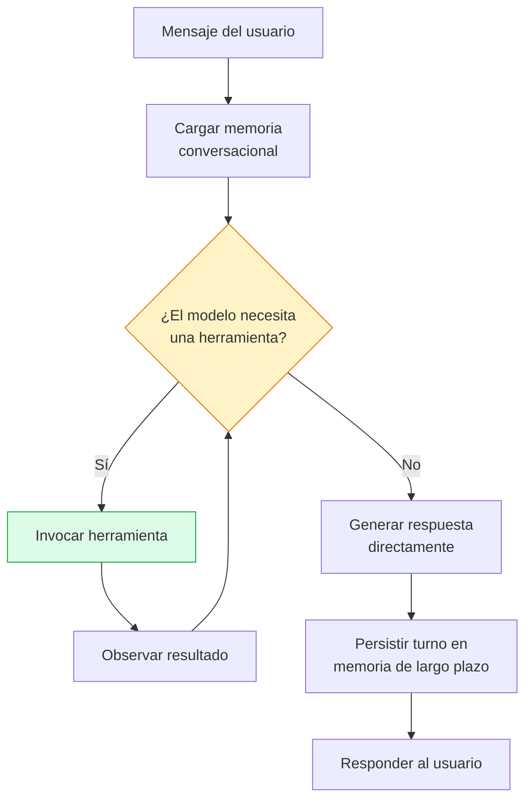

# Diseño del Wellness Coach Agent 2.0

**Issue #11 — Sprint técnico 2: Agentes Inteligentes Modernos**
Plataforma Inteligente Wellness 2.0 · Equipo 1

---

## 1. Propósito

El `WellnessAgent` existente (`src/agents/wellness/agent.py`, modos `legacy` y
`rag`) responde una pregunta implícita de un solo turno: *dado el estado actual
del corredor, ¿qué debería entrenar hoy?* No hay diálogo — se invoca, genera
una recomendación, termina.

El **Wellness Coach Agent 2.0** tiene un propósito distinto: **sostener una
conversación de coaching** con el corredor, en la que este puede preguntar,
pedir aclaraciones, matizar su situación a lo largo de varios turnos, y recibir
respuestas que tengan en cuenta tanto lo dicho anteriormente en la conversación
como el estado real de su entrenamiento y el conocimiento curado de la
plataforma.

No reemplaza al `WellnessAgent`: **coexisten**. La recomendación automática
periódica (`POST /agent/{userId}/analyze`) se mantiene sin cambios, para
comparación empírica continua entre arquitecturas (legacy vs. RAG vs. agente
conversacional). El coach agent se expone como un canal adicional —un módulo
de chat— donde el corredor puede conversar activamente, algo que ningún modo
anterior ofrecía.

## 2. Responsabilidades

| Responsabilidad | Descripción |
|---|---|
| Sostener contexto conversacional | Recordar lo dicho en turnos anteriores dentro de una conversación, y entre sesiones distintas (memoria de largo plazo, issue #12) |
| Decidir cuándo usar una herramienta | A diferencia del `WellnessAgent`, que ejecuta un flujo fijo de datos → prompt → generación, el coach agent decide en cada turno, según lo que el usuario pregunta, si necesita invocar una herramienta o puede responder directamente |
| Fundamentar respuestas de dominio en conocimiento verificable | Reutilizar el pipeline RAG existente para preguntas sobre entrenamiento, lesiones, nutrición, etc., preservando la trazabilidad que es la ventaja central del sistema desde el Sprint 1 |
| Razonar en múltiples pasos cuando la pregunta lo requiere | Encadenar Thought → Action → Observation (patrón ReAct, issue #14) en vez de responder en un único paso de generación |

**Lo que el coach agent explícitamente NO hace:** no reemplaza el flujo de
recomendación automática, no persiste recomendaciones en la colección
`recommendations` (esa sigue siendo responsabilidad exclusiva del
`WellnessAgent`), y no compite por el mismo endpoint — vive en rutas propias
bajo un prefijo distinto.

## 3. Entradas y salidas

**Entrada:** un mensaje de texto del corredor, más el identificador de
conversación (para recuperar memoria de turnos anteriores) y el `userId` (para
acceder a su estado de entrenamiento mediante las herramientas).

**Salida:** una respuesta conversacional en lenguaje natural. A diferencia del
`WellnessAgent`, que devuelve un JSON estructurado con campos fijos (`tipo`,
`mensaje`, `alerta`, etc.), el coach agent devuelve principalmente texto libre,
dado que su naturaleza es dialogar, no emitir un veredicto estructurado en cada
turno. Puede acompañar su respuesta con metadata de trazabilidad (fuentes
citadas, herramientas invocadas) cuando corresponda — el diseño exacto de ese
sobre de respuesta se resuelve al implementar el endpoint en el issue #12.

**Fuentes de información**, en orden de cuándo se consultan:

1. Memoria conversacional (issue #12) — contexto de turnos anteriores.
2. Herramientas (issue #13) — datos concretos del corredor o servicios
   externos, invocadas solo si el modelo determina que las necesita.
3. Conocimiento paramétrico de Gemini — para todo lo que no requiere ni datos
   del corredor ni fundamento documental.

## 4. Herramientas asociadas

Cuatro herramientas, todas envolviendo componentes ya existentes en el
repositorio — ninguna requiere construir infraestructura nueva desde cero,
solo exponerla al modelo mediante function calling (implementación: issue
#13).

| Herramienta | Qué hace | Envuelve | Depende de |
|---|---|---|---|
| `consultar_historial_sesiones` | Devuelve las sesiones recientes del corredor | `RepositorioCorredor.obtener_sesiones_recientes()` | Firestore (`sessions`) |
| `consultar_progreso_objetivo` | Compara la carga actual contra la meta activa | `RepositorioCorredor.calcular_carga_semanal()` + `obtener_objetivos_activos()` | Firestore (`sessions`, `goals`) |
| `consultar_clima` | Devuelve condiciones climáticas de la ciudad del corredor | Nueva integración con Open-Meteo (sin API key) | Campo `ciudad` en `PerfilCorredor` — puede no estar presente en perfiles anteriores a este sprint |
| `consultar_base_conocimiento` | Recupera fragmentos relevantes de la knowledge base curada | `src/rag/retriever/retriever.py` (`recuperar()`), ya operativo desde el Sprint 1 | ChromaDB + embeddings de Vertex AI |

### Por qué son herramientas y no llamadas directas

Las primeras dos herramientas envuelven funciones que el `WellnessAgent` ya
usa hoy — la diferencia no es la función en sí, es **quién decide invocarla**.
En `WellnessAgent.analyze()`, `cargar_estado_corredor()` se ejecuta siempre,
incondicionalmente, como parte de un flujo de código fijo. Como herramienta,
es Gemini quien decide, turno a turno y según lo que el usuario pregunte, si
esa consulta es necesaria. Si el corredor pregunta "¿qué es la zona 2?", el
agente no necesita consultar su historial de sesiones; si pregunta "¿cómo voy
esta semana?", sí. Esa capacidad de decidir en tiempo de conversación qué
acción tomar es, según el temario de la asignatura, precisamente lo que
distingue a un agente moderno de un flujo de ejecución fijo.

### Justificación de `consultar_base_conocimiento`

Sin esta herramienta, el coach agent respondería preguntas de dominio
(lesiones, tapering, nutrición) desde el conocimiento general de Gemini, sin
fuentes ni garantía de que no inventa una cita — exactamente el comportamiento
del modo `legacy`, que el Sprint 1 existió para superar. Incluir esta
herramienta extiende al canal conversacional la misma trazabilidad que ya
tiene el modo `rag` del `WellnessAgent`, reutilizando el retriever sin
duplicar lógica.

### Riesgo identificado: consulta de recuperación dependiente de contexto

En el modo RAG de un solo turno, la consulta de recuperación se construye de
una vez a partir del estado del corredor (`construir_consulta()` en
`rag_pipeline.py`). En una conversación, la pregunta que dispara la
recuperación puede depender de turnos anteriores — por ejemplo, "¿y si sigo
corriendo igual esta semana?" solo tiene sentido como consulta de búsqueda si
se conoce el tema del turno previo (una posible lesión, mencionada dos
mensajes atrás). Esto significa que `consultar_base_conocimiento` no puede
tomar el último mensaje del usuario tal cual como consulta de recuperación:
requiere que el propio modelo formule, como parte de su razonamiento, una
consulta que incorpore el contexto conversacional relevante. El mecanismo
concreto para esto se diseña en el issue #14 (patrón ReAct); se deja
registrado aquí para que la implementación de memoria (#12) y de tools (#13)
no asuma que la recuperación funciona igual que en el modo de un solo turno.

## 5. Prompt especializado

El prompt del coach agent difiere del prompt RAG existente
(`prompts/rag/wellness_rag.txt`) en un aspecto estructural: aquel asume que
todo el contexto relevante (chunks recuperados, estado del corredor) ya está
disponible de antemano y se inserta de una vez en un único prompt de
generación. El del coach agent debe, en cambio, describir a Gemini las
herramientas disponibles y las condiciones bajo las cuales debe invocar cada
una — es un prompt de **orquestación de herramientas**, no solo de generación
fundamentada.

Se diseña como parte de este mismo issue, en
`prompts/agents/wellness_coach_agent.txt` (pendiente de redactar en el
siguiente paso de #11), conservando los principios ya validados en el prompt
RAG: instrucciones de anclaje explícitas, fecha actual inyectada, validación
programática de citas cuando la respuesta involucre `consultar_base_conocimiento`.

## 6. Flujo de razonamiento (alto nivel)

Este diagrama describe el flujo a nivel conceptual — el ciclo `R → A → O → R`
es el patrón ReAct (Thought → Action → Observation), cuya implementación
concreta corresponde al issue #14. Se incluye aquí porque el criterio de
aceptación de #11 exige "modelar el flujo de razonamiento y toma de
decisiones" como parte del diseño, antes de implementarlo.

## 7. Ubicación en el código

src/agents/wellness_coach/
init.py
agent.py # WellnessCoachAgent (issues #12–#14)
memory.py # Estrategia de memoria de largo plazo (issue #12)
tools/
init.py
historial.py # consultar_historial_sesiones, consultar_progreso_objetivo
clima.py # consultar_clima (Open-Meteo)
conocimiento.py # consultar_base_conocimiento

Paquete nuevo, independiente de `src/agents/wellness/`, siguiendo la simetría
ya establecida con `src/agents/{nutrition,motivation,analytics}/` (reservados
para el Sprint 3). `RepositorioCorredor` (`src/data/repositorio_corredor.py`)
es compartido entre `WellnessAgent` y `WellnessCoachAgent` — ver
`docs/architecture/agent-architecture.md` §1.5 para el diagrama de esa
relación.

## 8. Coherencia con la arquitectura existente

- Reutiliza `RepositorioCorredor` (issue #10) sin duplicar acceso a datos.
- Reutiliza el retriever RAG (`src/rag/retriever/retriever.py`) sin
  modificarlo.
- No introduce ningún framework de agentes nuevo — se implementa sobre el SDK
  directo de Vertex AI (`vertexai.generative_models`), consistente con la
  decisión ya tomada por el equipo para este sprint (ver
  `docs/architecture/agent-architecture.md` §2.1, pendiente de completar al
  iniciar #13).
- Requiere un cambio de modelo de datos ya decidido: campo `ciudad` en el
  perfil de usuario (`users`), y una colección nueva `conversations` para la
  memoria de largo plazo (diseño detallado en el issue #12).

## 9. Alcance explícitamente fuera de este issue

Por tratarse de un issue de diseño, quedan fuera de #11 y se abordan en los
issues indicados:

- Implementación de las cuatro herramientas → #13
- Implementación de la memoria conversacional → #12
- Implementación del ciclo ReAct completo → #14
- El endpoint de chat (`POST /agent-coach/{userId}/chat`) → #12
- Casos de prueba y evaluación del comportamiento → #15

## 10. Corrección post-verificación real: reintento acotado ante declaración sin invocar (issue #15)

La verificación con Vertex AI real reveló que el modelo, en algunos turnos,
narra la intención de usar una herramienta ("voy a consultar la base de
conocimiento") o directamente atribuye contenido a ella ("según la base de
conocimiento...") sin emitir una llamada a función real. El ciclo ReAct
original cerraba el turno inmediatamente al no recibir `function_calls`,
entregando al usuario una promesa incumplida o una atribución falsa — el
mismo problema de cita alucinada identificado en el Sprint 1, en la
superficie conversacional.

### Alternativa considerada y descartada

Se investigó `ToolConfig` con `FunctionCallingConfig.Mode.ANY`, que fuerza
al modelo a emitir una llamada a función en vez de texto. Se descartó por
una limitación real del SDK, confirmada contra su documentación oficial:
`ChatSession.send_message()` no acepta un `tool_config` por mensaje — solo
puede fijarse a nivel de todo el `GenerativeModel`. Aplicarlo globalmente
forzaría una llamada a función en **cada** turno, incluidos los que
legítimamente no requieren ninguna (un saludo, una pregunta fuera de
dominio), rompiendo ese comportamiento correcto.

### Solución adoptada

Una heurística textual (`_declara_uso_de_herramienta_sin_invocar()` en
`src/agents/wellness_coach/agent.py`) que detecta frases características de
este patrón, con un reintento acotado a **una sola vez por turno**: si el
modelo declara intención sin invocar, se le reenvía un mensaje explícito
pidiéndole que invoque la función en vez de narrarla. Si el reintento
tampoco produce una llamada real, se descarta el texto del modelo (no se
confía en una segunda promesa) y se sustituye por una respuesta honesta que
admite no haber podido completar la consulta.

La heurística solo se evalúa cuando **ninguna herramienta se ha invocado
todavía en el turno actual** — citar "según la base de conocimiento"
después de haber invocado realmente `consultar_base_conocimiento` es una
atribución legítima, no una señal de alarma.

### Limitaciones conocidas, documentadas explícitamente

- **Falsos negativos**: si el modelo declara la intención con una frase no
  incluida en la lista, no se detecta y el turno se cierra con una promesa
  incumplida. La lista se amplía empíricamente a medida que se observan
  nuevas formulaciones en evaluaciones posteriores.
- **Falsos positivos**: el uso legítimo de alguna de estas frases sin ser
  una promesa vacía consume un reintento innecesario — costo aceptable
  frente al riesgo de una atribución falsa sin corregir.

Esta es una mitigación heurística, no una garantía estructural — a
diferencia de `validar_fuentes()` del Sprint 1, que sí ofrece una garantía
programática completa sobre las citas del modo RAG de un solo turno. Queda
como candidato de mejora futura evaluar si versiones más recientes del SDK
permiten aplicar `tool_config` por mensaje dentro de una sesión de chat.