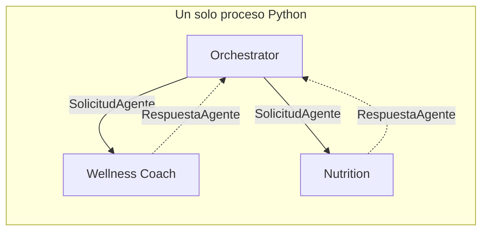

# Nota arquitectónica — Evolución hacia MCP y A2A

**Issue S3-04 (#20) — Sprint técnico 3: Sistemas Multiagente**
Plataforma Inteligente Wellness 2.0 · Equipo 1

El issue pide *«analizar brevemente cómo la arquitectura podría evolucionar
hacia mecanismos de interoperabilidad como MCP o A2A»*, y aclara que se
consideran **arquitectónicamente, sin requerir una implementación completa**.
Esta nota cumple ese alcance: analiza qué habría que cambiar, qué ya está
preparado y bajo qué condiciones convendría hacerlo.

No se implementa ninguno de los dos protocolos en este sprint.

---

## 1. Dónde está hoy el sistema

Los tres agentes viven en el mismo proceso Python. Una delegación es una
llamada de función a través del invocador registrado en `registro_agentes.py`,
y el intercambio está tipado por `SolicitudAgente` y `RespuestaAgente`
(`src/orchestration/communication/contratos.py`).

Eso significa que **el sistema ya tiene una frontera de comunicación
explícita**, aunque no la cruce por red. Es la diferencia entre tener que
diseñar un protocolo desde cero y tener que serializar uno que ya existe.

---

## 2. Los dos protocolos resuelven problemas distintos

Conviene no tratarlos como alternativas, porque no compiten: operan en capas
diferentes.

| | **MCP** (Model Context Protocol) | **A2A** (Agent-to-Agent) |
|---|---|---|
| Qué estandariza | Cómo un modelo accede a **herramientas y fuentes de datos** | Cómo **dos agentes autónomos** se descubren y colaboran |
| Relación típica | Cliente ↔ servidor de capacidades | Par ↔ par, o delegación entre organizaciones |
| En este sistema aplicaría a | Las cuatro herramientas del Coach y la recuperación RAG | La relación orquestador ↔ agentes especializados |

Dicho de otro modo: **MCP miraría hacia abajo** —cómo los agentes alcanzan sus
capacidades— y **A2A miraría hacia los lados** —cómo los agentes se hablan
entre sí.

---

## 3. Evolución hacia MCP

### 3.1 Qué se expondría

Las capacidades que hoy son funciones Python invocadas por tool calling:

| Capacidad actual | Como servidor MCP |
|---|---|
| `consultar_historial_sesiones` | Servidor de datos del corredor (Firestore) |
| `consultar_progreso_objetivo` | Servidor de datos del corredor (Firestore) |
| `consultar_clima` | Servidor de clima (Open-Meteo) |
| `consultar_base_conocimiento` | Servidor de conocimiento (ChromaDB, con filtro por categoría) |

### 3.2 Qué está ya preparado

**El registro de herramientas es declarativo.** `_HERRAMIENTAS` en
`src/agents/wellness_coach/tools/registro.py` es una lista de diccionarios con
nombre, descripción y esquema de parámetros — que es, en esencia, lo que un
servidor MCP publica en su descubrimiento de herramientas. La conversión sería
una transformación de formato, no un rediseño.

**El despacho está centralizado.** Todas las invocaciones pasan por
`despachar()`, así que sustituir la ejecución local por una llamada a un
servidor MCP toca un solo punto.

**La degradación ya está resuelta ahí mismo.** `_despachar_con_degradacion()`
(corrección S2-04) convierte cualquier fallo en una observación controlada. Un
servidor MCP remoto añade modos de fallo nuevos —red, timeout, servidor
caído— pero el punto donde tratarlos ya existe y ya los absorbe.

### 3.3 Qué habría que construir

- Un servidor MCP por grupo de capacidades, con su descubrimiento.
- Autenticación entre el agente y los servidores, que hoy no existe porque
  todo corre en el mismo proceso con las mismas credenciales.
- Manejo de latencia adicional por salto de red, sobre una latencia que ya es
  alta (~26 s en un flujo colaborativo).

### 3.4 Qué se ganaría, y cuándo

El beneficio real de MCP aparece cuando **las capacidades se comparten entre
consumidores distintos**. Hoy la base de conocimiento la usan dos agentes del
mismo proceso; exponerla por MCP no aporta nada que un import no resuelva.

Convendría si el módulo administrativo de ingesta documental previsto en el
roadmap se construyera como servicio aparte, o si un cliente externo a la
plataforma necesitara consultar la knowledge base curada.

---

## 4. Evolución hacia A2A

### 4.1 Qué cambiaría

`SolicitudAgente` y `RespuestaAgente` pasarían de ser dataclasses en memoria a
mensajes serializados sobre un transporte. El mapeo es casi directo:

| Campo actual | Equivalente A2A |
|---|---|
| `traza_id` | Identificador de correlación de la conversación |
| `user_id` | Contexto de identidad, propagado con autorización explícita |
| `mensaje` | Contenido de la tarea |
| `intencion` | Capacidad solicitada |
| `contexto` | Historial de la tarea |
| `paso` | Número de secuencia |
| `RespuestaAgente.degradado` | Estado de la tarea: completada con degradación |

Que el mapeo sea tan directo **no es casualidad: es la consecuencia de haber
definido el contrato explícitamente en S3-04** en lugar de pasar diccionarios
sueltos. Ese trabajo, que en su momento se hizo por claridad interna, es el que
haría barata esta migración.

### 4.2 Qué está ya preparado

**El descubrimiento tiene dónde apoyarse.** A2A define *agent cards*:
descripciones publicadas de qué sabe hacer cada agente. El registro ya contiene
exactamente esa información —`nombre`, `titulo`, `descripcion`, `intencion`— y
se usa para generar el catálogo del clasificador. Un agent card sería esa misma
entrada serializada.

**La topología es compatible.** El patrón Supervisor mapea sobre el modelo
cliente-servidor de A2A sin violencia: el orquestador es cliente, los
especializados son servidores de tareas.

**No hay ciclos que resolver.** Los agentes no delegan entre sí, así que no
habría que diseñar detección de ciclos distribuida — el problema más incómodo
de un sistema A2A con delegación horizontal.

### 4.3 Qué habría que construir

- **Autenticación y autorización entre agentes.** Hoy el `user_id` viaja en la
  solicitud y se confía en él porque el orquestador lo inyecta desde el mismo
  proceso. Entre servicios haría falta un token que acredite que el orquestador
  tiene derecho a pedir datos de ese corredor. **Es el cambio más importante y
  el menos trivial**: la garantía de que un mensaje del usuario no puede
  inducir a consultar datos de otro corredor hoy es estructural, y en un
  sistema distribuido pasaría a depender de la autorización.
- Tareas asíncronas y de larga duración, que A2A contempla y aquí no existen.
- Reintentos y tolerancia a fallos de red, hoy deliberadamente ausentes.
- Versionado de los contratos, porque dos servicios se despliegan por separado
  y pueden quedar desalineados.

### 4.4 Qué se ganaría, y cuándo

A2A tiene sentido cuando los agentes **pertenecen a dominios de despliegue o de
propiedad distintos**: equipos que liberan por separado, o agentes de terceros.
Con dos agentes del mismo equipo en el mismo repositorio, introduce
autenticación, versionado y fallos de red a cambio de nada.

Convendría si la plataforma incorporara un agente de un proveedor externo —por
ejemplo un servicio de nutrición clínica—, o si los agentes de motivación y
analítica del roadmap los mantuviera otro equipo con su propio ciclo de
despliegue.

---

## 5. Recomendación

**No adoptar ninguno de los dos en el estado actual.** No por conservadurismo,
sino porque ambos resuelven problemas de sistemas distribuidos que este sistema
todavía no tiene, y cobran por adelantado: autenticación, versionado, latencia
de red y modos de fallo nuevos.

El trabajo hecho en S3-04 es, en la práctica, la preparación para esa
migración. Definir el contrato explícitamente, centralizar el despacho, mantener
el registro declarativo y correlacionar por `traza_id` son exactamente las
piezas que haría falta serializar. **La distancia entre este sistema y uno
interoperable es de transporte y seguridad, no de diseño.**

Orden razonable, si llegara el momento:

1. **MCP primero, sobre la base de conocimiento**, cuando exista un segundo
   consumidor fuera del proceso. Es el cambio más acotado y el que menos
   superficie de seguridad abre.
2. **A2A después**, cuando un agente deje de pertenecer a este equipo o a este
   despliegue.

---

## 6. Alcance de esta nota

Análisis arquitectónico, sin implementación, tal como plantea el issue. No se
añaden dependencias, no se modifica el código, y los directorios
`src/orchestration/communication/{mcp,a2a}/` del scaffold permanecen vacíos a
propósito: crear estructura para algo que no se va a construir en este sprint
solo produciría la impresión de un avance que no existe.
