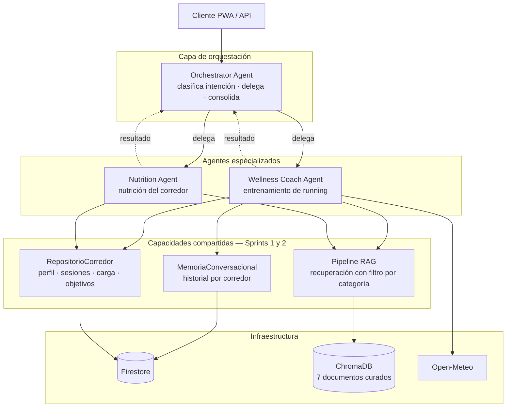
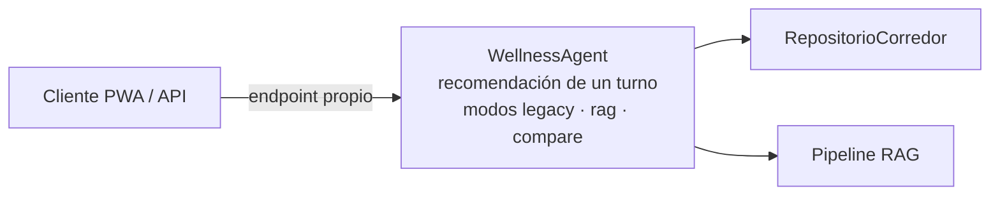
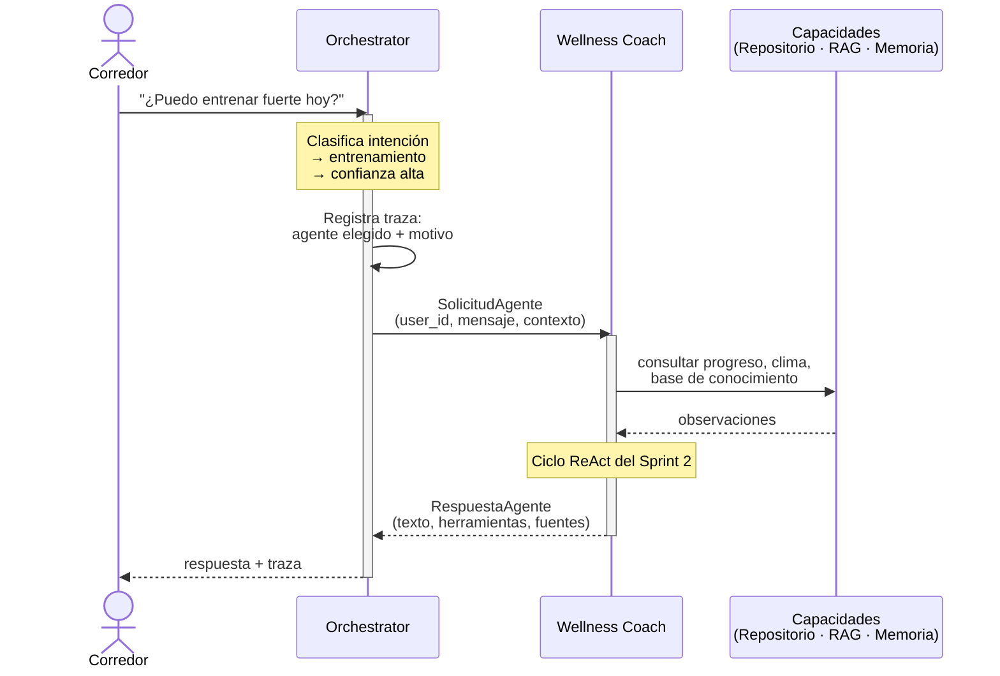
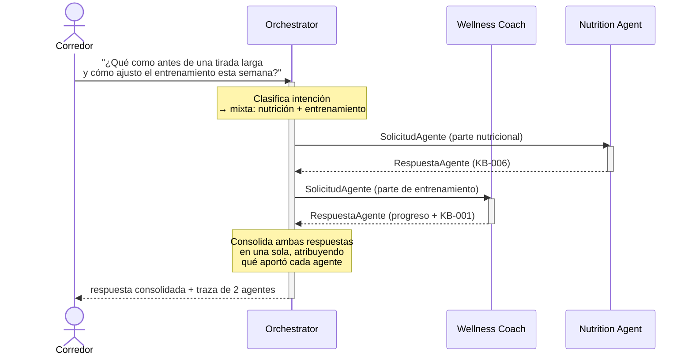
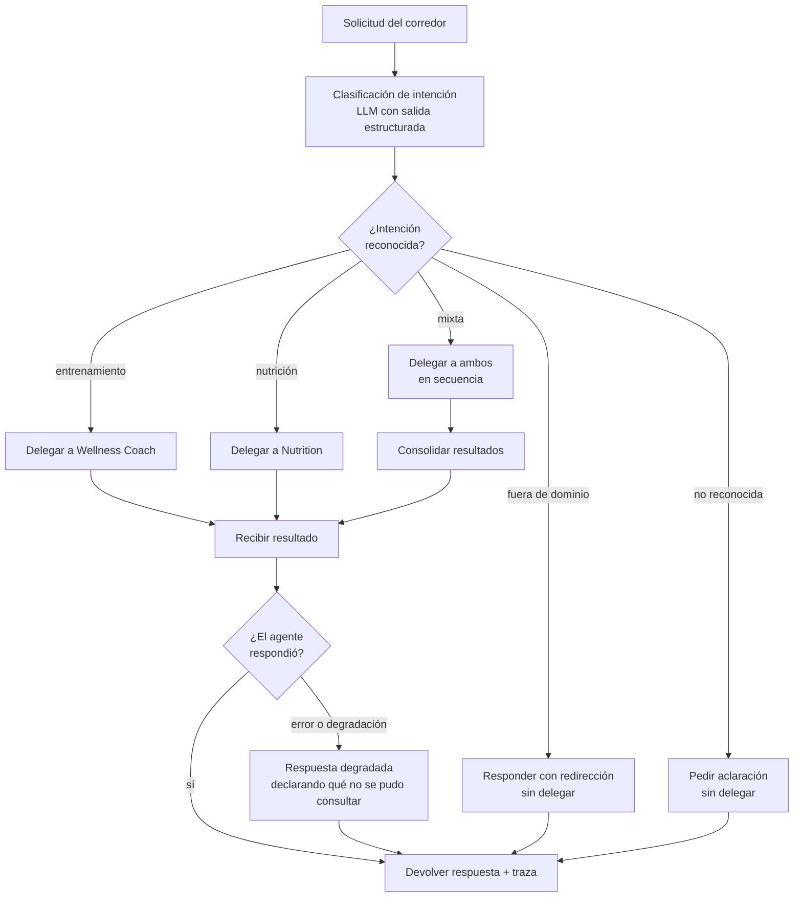

# Arquitectura Multiagente — Sprint 3

**Issue S3-01 (#17) — Sprint técnico 3: Sistemas Multiagente**
Plataforma Inteligente Wellness 2.0 · Equipo 1

Este documento define la arquitectura multiagente de la plataforma Wellness.
Complementa a `docs/architecture/rag-architecture.md` (Sprint 1, pipeline RAG y
modo dual) y a `docs/architecture/agent-architecture.md` (Sprint 2, agente
conversacional con memoria, herramientas y ReAct). Ninguno de los dos se
reemplaza: el Sprint 3 los coordina.

---

## 1. Punto de partida

Al cierre del Sprint 2 la plataforma tiene dos agentes que no se conocen entre
sí, y un componente de acceso a datos que ambos comparten.

| Componente | Origen | Qué hace |
|---|---|---|
| `WellnessAgent` | Sprint 1 | Recomendación de un turno, modos `legacy` y `rag` |
| `WellnessCoachAgent` | Sprint 2 | Conversación con memoria, 4 herramientas, ciclo ReAct |
| `RepositorioCorredor` | Sprint 2 (#10) | Acceso a perfil, sesiones, carga semanal y objetivos |
| Pipeline RAG | Sprint 1 | Recuperación sobre 7 documentos curados, con filtro por categoría |

La entrada al sistema es directa: el cliente sabe a qué endpoint llamar. No
existe ningún componente que decida qué agente debe atender una solicitud,
porque hasta ahora la respuesta era obvia.

**El Sprint 3 introduce esa decisión**, y con ella el problema de coordinación
que define un sistema multiagente.

---

## 2. Agentes del sistema

### 2.1 Roster y responsabilidades

| Agente | Responsabilidad | Fuera de su alcance |
|---|---|---|
| **Orchestrator Agent** | Recibir la solicitud, determinar la intención, delegar al agente competente, devolver el resultado. Emitir por sí mismo las respuestas de control del flujo | No genera respuestas especializadas de dominio ni consulta la base de conocimiento |
| **Wellness Coach Agent** | Entrenamiento de running: carga, intensidad, lesiones, tapering, recuperación, progreso del corredor | Nutrición, hidratación y pautas alimentarias |
| **Nutrition Agent** | Nutrición del corredor: ingesta, hidratación, pautas antes/durante/después del entrenamiento | Prescripción de entrenamiento y análisis de carga |

La fila del orquestador distingue dos cosas que conviene no confundir. El
orquestador **sí** produce texto dirigido al corredor en tres situaciones, todas
de control del flujo: cuando no reconoce la intención y pide aclaración, cuando
la consulta queda fuera del dominio de la plataforma y redirige, y cuando un
agente falla y hay que declararlo. Son respuestas fijas, no generadas, y su
contenido es sobre la conversación, no sobre running.

Lo que **no** hace es producir contenido especializado: no responde una pregunta
de entrenamiento ni de nutrición, no consulta la base de conocimiento, no accede
a los datos del corredor y no reescribe lo que dicen los agentes. Esa es la
frontera que lo mantiene siendo un coordinador. Si empezara a resolver casos por
su cuenta, el sistema tendría la lógica de dominio repartida entre el
coordinador y los especialistas, que es precisamente lo que el patrón Supervisor
busca evitar. Las cuatro situaciones previstas y su respuesta están en la
sección 6.

El **Wellness Coach** es el agente especializado asignado a este equipo. El
**Nutrition Agent** se incorpora como segundo participante por una razón
concreta: los criterios de aceptación de S3-04 y S3-06 exigen *"al menos un
escenario verificable de colaboración entre agentes"*, y con un único agente
especializado la delegación degenera en un enrutador con un solo destino. Se
declara explícitamente como pieza de soporte del ejercicio multiagente, no como
un segundo entregable de especialización.

El `WellnessAgent` del Sprint 1 permanece fuera del sistema multiagente. Su
salida es un JSON estructurado que el frontend renderiza como tarjeta, no una
respuesta conversacional: incorporarlo al flujo de delegación mezclaría dos
contratos de salida distintos sin beneficio. Sigue accesible por su endpoint
propio, incluido `/compare`.

### 2.2 La frontera de responsabilidad como garantía estructural

El criterio de aceptación de S3-03 exige que cada agente *"evite asumir
responsabilidades correspondientes a otros agentes"*. La forma directa de
lograrlo es instruirlo en el prompt. **No es suficiente**, y el Sprint 2 lo
demostró: los hallazgos E y F documentan tres rondas de medición corrigiendo un
comportamiento que el prompt describía correctamente y el modelo aplicaba a su
manera.

La arquitectura aplica la frontera **en el acceso a datos**, donde el modelo no
tiene margen de interpretación. Las siete categorías de la taxonomía del Sprint
1 se reparten entre los dos agentes:

| Agente | Categorías accesibles | Documentos |
|---|---|---|
| Wellness Coach | `carga_entrenamiento`, `zonas_fisiologicas`, `distribucion_intensidad`, `prevencion_lesiones`, `tapering`, `recuperacion` | KB-001, KB-002, KB-003, KB-004, KB-005, KB-007 |
| Nutrition | `nutricion` | KB-006 |

`recuperar()` ya acepta un filtro de categoría desde el Sprint 1
(`src/rag/retriever/retriever.py`). La herramienta de conocimiento de cada
agente lo aplicará con su conjunto propio, de modo que **el Coach no puede
citar KB-006 aunque el prompt fallara**: esos fragmentos no llegan a su
contexto.

> **Cambio requerido:** `recuperar()` acepta hoy una sola categoría. Habrá que
> extenderlo para aceptar una lista (`{"categoria": {"$in": [...]}}` en el
> filtro de ChromaDB). Es un cambio acotado, previsto para S3-03.

El prompt sigue existiendo y sigue importando —gobierna el tono, la derivación
y el reconocimiento de cuándo una pregunta no le corresponde— pero deja de ser
la única línea de defensa.

---

## 3. Patrón de orquestación

### 3.1 Evaluación de los cuatro patrones

| Patrón | Qué supone | Ajuste a este sistema |
|---|---|---|
| **Sequential** | Un pipeline fijo por el que pasan todas las solicitudes | **No.** La ruta depende de la intención: una pregunta de entrenamiento no debe atravesar el agente de nutrición |
| **Hierarchical** | Supervisores anidados que coordinan subgrupos de agentes | **No.** Con dos agentes especializados no hay subgrupos que anidar; añade una capa sin contenido |
| **Swarm** | Los agentes se pasan el control entre sí, sin punto central | **No.** Sin un punto único de decisión, reconstruir el recorrido de una solicitud exige correlacionar trazas de cada agente. S3-06 exige *"trazabilidad suficiente para comprender el recorrido de una solicitud"*: Swarm juega en contra del propio sprint |
| **Supervisor** | Un coordinador central recibe, decide, delega y devuelve | **Sí.** Ver 3.2 |

### 3.2 Justificación del patrón Supervisor

Se adopta **Supervisor**. Tres razones, en orden de peso:

**1. Un solo punto de decisión produce un solo punto de traza.** Cada solicitud
atraviesa el orquestador al entrar y al salir, de modo que la traza completa
—intención detectada, agente elegido, motivo de la elección, resultado— se
construye en un único lugar. Con Swarm habría que correlacionar registros
emitidos por agentes distintos para responder *"¿qué pasó con esta solicitud?"*.

**2. La lógica de coordinación queda separada de la lógica de los agentes**,
que es un criterio de aceptación explícito de S3-02. Los agentes especializados
no necesitan saber que existen otros agentes: reciben una solicitud y devuelven
una respuesta. Quién los llamó y qué se hace con el resultado no es asunto
suyo.

**3. Es el patrón que el sistema ya insinuaba.** El ciclo ReAct del Sprint 2 ya
es un supervisor en pequeño: un bucle central que decide qué herramienta
invocar, la despacha y procesa su observación. El Sprint 3 eleva ese mismo
patrón un nivel — de herramientas a agentes. La continuidad conceptual no es
casual y facilita razonar sobre el sistema completo.

**Contrapartida asumida.** El orquestador es un punto único de fallo y añade
una llamada al modelo por solicitud, con su latencia. Lo primero se mitiga con
el manejo de errores de la sección 6; lo segundo se medirá en S3-06 y se
reportará como costo del patrón, no se ocultará.

---

## 4. Diagramas

### 4.1 Arquitectura del sistema

Se representa únicamente el flujo multiagente. El `WellnessAgent` del Sprint 1
queda fuera por la razón expuesta en 2.1 y conserva su endpoint propio sobre
`RepositorioCorredor` y el pipeline RAG, sin pasar por el orquestador.

Las llamadas a Vertex AI se omiten como aristas individuales para no saturar el
diagrama: **el orquestador y los dos agentes especializados invocan a Gemini**,
y el pipeline RAG lo usa además para generar embeddings de consulta.

Y el acceso del agente del Sprint 1, que permanece separado:

### 4.2 Flujo de orquestación — delegación simple

### 4.3 Flujo de orquestación — colaboración entre agentes

### 4.4 Decisión de delegación

---

## 5. Mecanismo de delegación

### 5.1 Clasificación de intención

El orquestador determina el agente competente mediante **una llamada al modelo
con salida estructurada**, no mediante reglas sobre palabras clave.

Justificación:

- **Las preguntas reales son ambiguas o mixtas.** *"¿Qué como antes de una
  tirada larga y cómo ajusto el entrenamiento?"* no se resuelve con
  coincidencia de términos, y es justamente el caso que S3-04 exige demostrar.
- **La decisión debe ser explicable.** El modelo devuelve el motivo de su
  elección junto con el agente, y ese motivo entra en la traza. Una regla no
  explica por qué descartó las alternativas.
- **Es coherente con el resto del sistema**, que ya delega decisiones de este
  tipo al modelo (qué herramienta invocar, en el ciclo ReAct).

Costo asumido: una llamada adicional por solicitud. Se mide en S3-06.

### 5.2 Contrato de mensajes

La comunicación entre orquestador y agentes usa dos estructuras explícitas. El
detalle de implementación corresponde a S3-04; aquí se fija la forma.

**Solicitud — orquestador → agente**

| Campo | Contenido |
|---|---|
| `user_id` | Corredor que origina la solicitud. Lo inyecta el orquestador, nunca el modelo |
| `mensaje` | Texto dirigido al agente. En delegación mixta, la porción que le corresponde |
| `intencion` | Categoría detectada por el clasificador |
| `contexto` | Lo que el agente necesita y no puede deducir: respuestas de agentes previos en flujos de colaboración |
| `traza_id` | Identificador de la solicitud completa, para correlacionar registros |

**Respuesta — agente → orquestador**

| Campo | Contenido |
|---|---|
| `texto` | Respuesta en lenguaje natural |
| `agente` | Quién la produjo |
| `herramientas_invocadas` | Para trazabilidad y evaluación |
| `fuentes` | `doc_id` realmente recuperados, heredando la regla de citación del Sprint 1 |
| `degradado` | Si alguna capacidad falló durante la ejecución |

El `user_id` viaja en la solicitud y **no proviene del modelo**, misma decisión
que el Sprint 2 tomó para `despachar()`: elimina por construcción la
posibilidad de que un mensaje induzca a consultar datos de otro corredor.

### 5.3 Prevención de ciclos

S3-04 exige *"evitar ciclos de delegación o llamadas innecesarias"*. El patrón
Supervisor lo resuelve por construcción: **los agentes especializados no pueden
delegar**. Solo el orquestador delega, y lo hace sobre una lista finita
determinada antes de invocar al primer agente. Un agente que reciba una
pregunta fuera de su alcance lo declara en su respuesta; no la reenvía.

---

## 6. Manejo de errores de orquestación

Cuatro situaciones previstas, con su respuesta:

| Situación | Comportamiento |
|---|---|
| Intención no reconocida | No se delega. Se pide aclaración al corredor |
| Intención fuera del dominio de la plataforma | No se delega. Se redirige amablemente, como ya hace el Coach en AG-09 |
| El agente delegado falla | Respuesta degradada que declara qué no pudo consultarse. Se reutiliza el contrato `{"disponible": False, ...}` del hallazgo D |
| En colaboración, un agente falla y el otro responde | Se entrega la parte disponible, declarando explícitamente la que falta |

La cuarta es la que importa. Es la misma lección de la corrección S2-04: el
valor de degradar no está en no caerse, sino en **conservar lo que sí
funcionó**.

---

## 7. Decisiones arquitectónicas registradas

| # | Decisión | Alternativa descartada | Motivo |
|---|---|---|---|
| D-01 | Patrón Supervisor | Swarm, Sequential, Hierarchical | Trazabilidad centralizada y separación de la lógica de coordinación |
| D-02 | Clasificación de intención por LLM | Reglas sobre palabras clave | Preguntas mixtas y decisión explicable |
| D-03 | Frontera de dominio por filtro de categoría | Solo instrucción en el prompt | Garantía estructural; los hallazgos E y F mostraron el límite del prompt |
| D-04 | Nutrition Agent como segundo participante | Un solo agente especializado | Sin un segundo agente no hay colaboración que verificar |
| D-05 | `WellnessAgent` fuera del flujo multiagente | Incorporarlo como tercer agente | Su salida es JSON estructurado, no conversacional |
| D-06 | Los agentes no delegan entre sí | Delegación horizontal | Elimina los ciclos por construcción |
| D-07 | SDK directo de Vertex AI | LangGraph | Se reevaluó para este sprint: ver 7.1 |

### 7.1 Sobre LangGraph

El Sprint 2 descartó los frameworks de agentes y dejó anotado que *"para el
Sprint 3 la evaluación cambia: coordinar varios agentes sí es el caso de uso
donde un framework de orquestación aporta algo"*.

Reevaluado con el alcance real del sprint —dos agentes especializados y un
patrón Supervisor sin estado compartido entre pasos— la conclusión se mantiene:
el grafo que LangGraph construiría tiene tres nodos y dos aristas. Se
implementa en menos código del que costaría la integración, y el conflicto de
resolución de dependencias con `firebase-admin` sobre `google-cloud-storage`
sigue vigente.

La decisión se revisaría con un roster mayor, ramificación condicional
compleja, o necesidad de estado persistente entre pasos del grafo. Se registra
aquí para que la reevaluación futura parta de un criterio y no de una
preferencia.

---

## 8. Alcance: qué no incluye este sprint

| Elemento | Estado | Motivo |
|---|---|---|
| **MCP / A2A** | Nota arquitectónica, sin implementación | Lo pide así el issue S3-04. Se documentará cómo evolucionaría el contrato de mensajes de 5.2 hacia un protocolo interoperable |
| **BigQuery** | No aplica | El volumen de datos actual —decenas de documentos por corredor— se resuelve en Firestore. Se justificará en S3-05 |
| **Agentes Motivation y Analytics** | Directorios vacíos | Fuera de la asignación del equipo |
| **Memoria compartida entre agentes** | No | Cada agente conserva la suya. El contexto entre agentes viaja en el campo `contexto` de la solicitud |

---

## 9. Coherencia con la arquitectura existente

La propuesta no reescribe nada de los sprints anteriores:

- `RepositorioCorredor` se consume igual, sin cambios.
- El ciclo ReAct del `WellnessCoachAgent` se conserva completo, incluidos el
  reintento del hallazgo C y la degradación de S2-04.
- El pipeline RAG se reutiliza; el único cambio es admitir una lista de
  categorías en `recuperar()`.
- La memoria conversacional sigue siendo por corredor y propiedad del Coach.
- El endpoint `/compare` del Sprint 1 sigue funcionando sin tocarlo.

Lo que se agrega es una capa por encima, no una sustitución de lo que hay
debajo.
