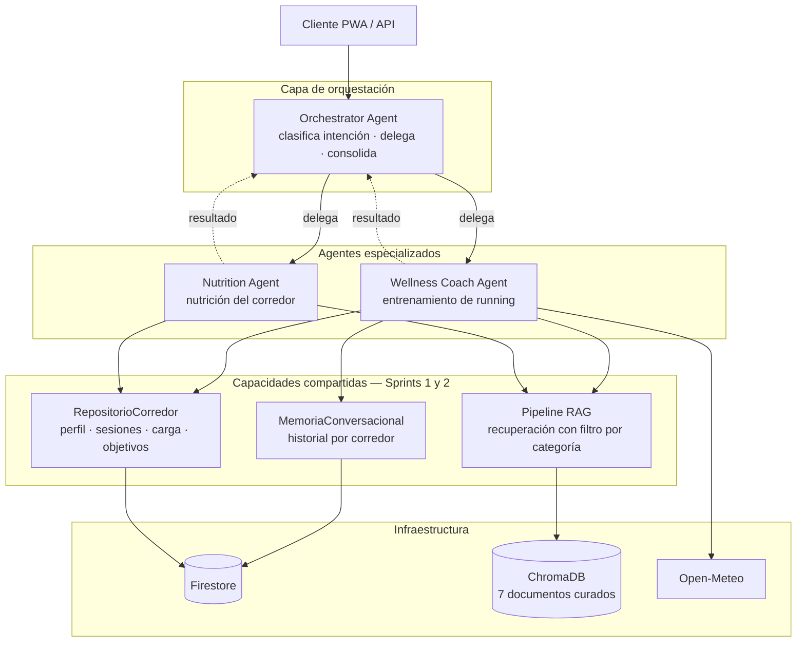
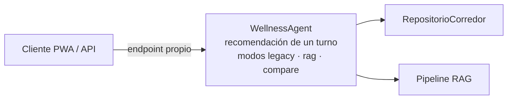
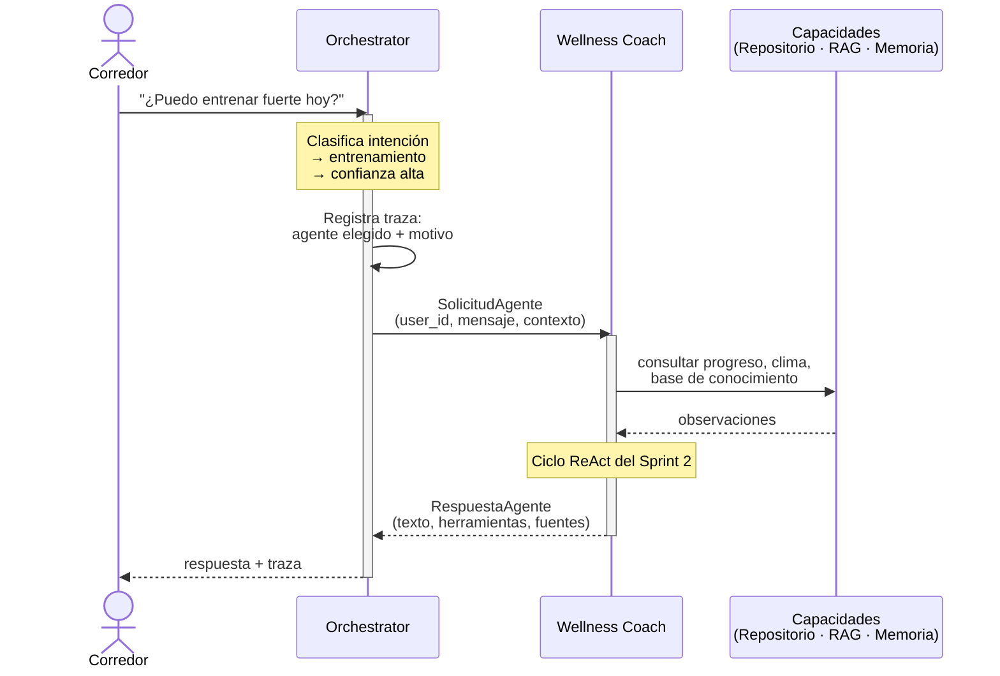
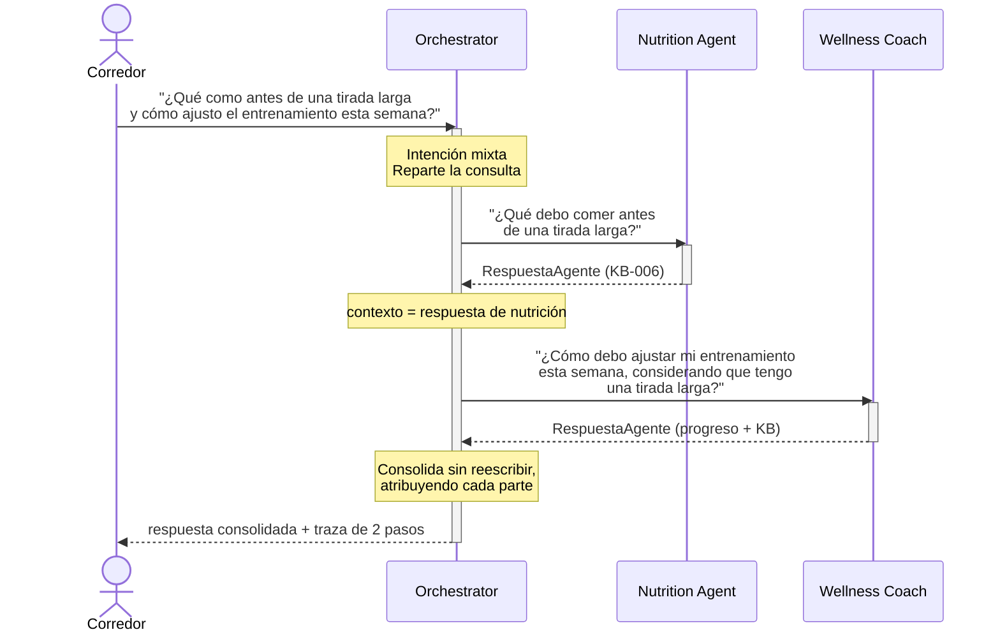
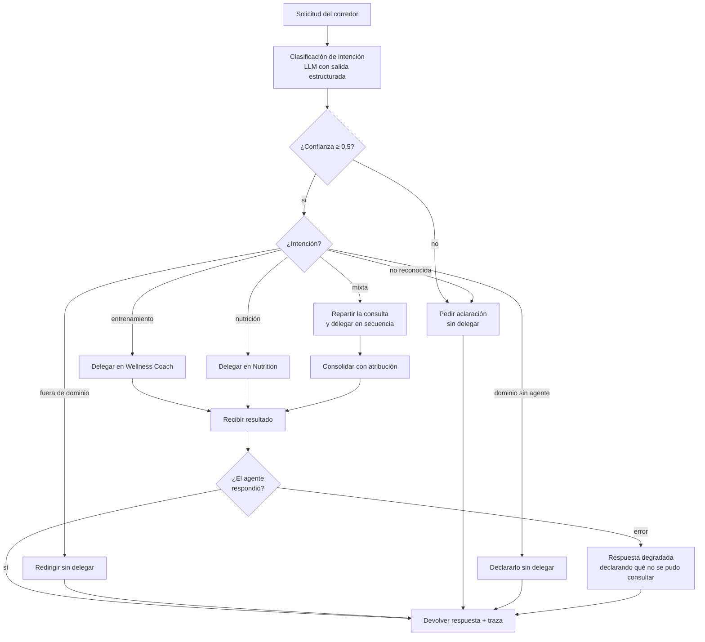

# Flujo de Orquestación — Diagramas

**Sprint 3 — Sistemas Multiagente** · Plataforma Inteligente Wellness 2.0 · Equipo 1

Vista gráfica del sistema multiagente. Cada diagrama enlaza al documento donde
se justifica lo que representa.

---

## 1. Arquitectura del sistema multiagente

Las llamadas a Vertex AI se omiten como aristas individuales para no saturar el
diagrama: **el orquestador y los dos agentes especializados invocan a Gemini**,
y el pipeline RAG lo usa además para generar embeddings de consulta.

El `WellnessAgent` del Sprint 1 queda fuera del flujo multiagente —su salida es
JSON estructurado, no conversacional— y conserva su endpoint propio:

> Justificación del roster y de las fronteras:
> `multiagent-architecture.md`

---

## 2. Delegación simple

---

## 3. Colaboración entre agentes

El caso MA-08 de la evaluación, con el reparto real que produjo el clasificador.

Obsérvese que la sub-consulta de entrenamiento **conserva que hay una tirada
larga prevista**, aunque ese detalle apareciera en la frase nutricional del
mensaje original. Sin esa regla, repartir empeoraría la respuesta en vez de
mejorarla.

> Las tres reglas del reparto: `docs/orchestration/delegation-rules.md`,
> sección 3.

---

## 4. Árbol de decisión de delegación

> Los cinco motivos de no delegación y el orden de las comprobaciones:
> `docs/orchestration/delegation-rules.md`, sección 2.

---

## 5. Documentos relacionados

| Tema | Documento |
|---|---|
| Arquitectura y roster de agentes | `multiagent-architecture.md` |
| Justificación del patrón Supervisor | `docs/orchestration/orchestration-pattern.md` |
| El componente orquestador | `docs/orchestration/orchestrator-agent.md` |
| Política de delegación | `docs/orchestration/delegation-rules.md` |
| Contrato de mensajes | `docs/orchestration/communication-flow.md` |
| Integraciones de datos | `integraciones-datos.md` |
