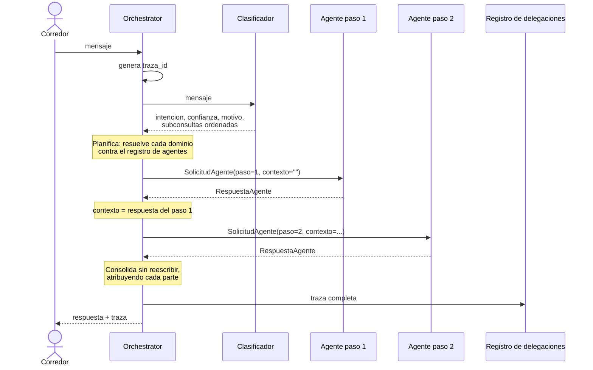

# Protocolo de Comunicación y Delegación entre Agentes

**Issue S3-04 (#20) — Sprint técnico 3: Sistemas Multiagente**
Plataforma Inteligente Wellness 2.0 · Equipo 1

Este documento especifica cómo el Orchestrator Agent y los agentes
especializados intercambian información. Complementa a
`docs/architecture/multiagent-architecture.md` (S3-01), que define la
arquitectura y el patrón; aquí se detalla el mecanismo.

---

## 1. Qué es y qué no es este protocolo

Los agentes viven en el mismo proceso: una delegación es una llamada de
función, no una petición de red. Este documento **no** especifica un transporte.

Lo que especifica es **qué información acompaña a una delegación y qué
información vuelve**. Esa distinción importa por dos razones. La primera es que
un contrato explícito es lo que permite que el orquestador no conozca la forma
interna de cada agente. La segunda es que, si algún día estos agentes se
separan en servicios distintos, lo que habría que serializar es exactamente
esto — ver `interoperabilidad-mcp-a2a.md`.

Hasta S3-03 la comunicación usaba diccionarios sueltos: cada adaptador devolvía
las claves que le parecían y el orquestador confiaba en que estuvieran.
Funciona con dos agentes y se vuelve frágil con más, porque nada declara qué
debe viajar ni qué puede faltar.

---

## 2. Las dos estructuras

Definidas en `src/orchestration/communication/contratos.py`.

### 2.1 `SolicitudAgente` — del orquestador al agente

| Campo | Tipo | Qué lleva |
|---|---|---|
| `traza_id` | `str` | Identificador de la solicitud completa del corredor |
| `user_id` | `str` | Corredor que la origina |
| `mensaje` | `str` | Lo que se le pide a **este** agente |
| `intencion` | `str` | Dominio que atiende esta delegación |
| `contexto` | `str` | Lo que respondió el agente anterior, si lo hubo |
| `paso` | `int` | Posición dentro del flujo, empezando en 1 |

**`traza_id` es el mismo para todas las delegaciones de un mensaje.** Un flujo
con dos agentes produce dos solicitudes con el mismo `traza_id` y distinto
`paso`, de modo que el recorrido completo se reconstruye correlacionando por
ese campo. Es lo que hace posible el criterio de S3-06 sobre reconstruir el
flujo de una solicitud.

**`user_id` no proviene del modelo.** Lo inyecta el orquestador desde el
contexto de la petición HTTP. Es la misma decisión que el Sprint 2 tomó para
`despachar()`: elimina por construcción la posibilidad de que un mensaje del
usuario induzca a consultar datos de otro corredor.

**`mensaje` es la parte que le toca**, no la consulta entera. Ver sección 4.

### 2.2 `RespuestaAgente` — del agente al orquestador

| Campo | Tipo | Qué lleva |
|---|---|---|
| `agente` | `str` | Quién respondió |
| `texto` | `str` | La respuesta en lenguaje natural |
| `herramientas_invocadas` | `list[str]` | Para trazabilidad |
| `fuentes` | `list[str]` | `doc_id` realmente recuperados |
| `degradado` | `bool` | Si alguna capacidad falló |
| `fallo` | `bool` | Si el agente no llegó a producir contenido de dominio |
| `detalle` | `dict` | Información específica del agente |
| `latencia_ms` | `int` | Lo que tardó este agente |

Tres campos tienen semántica que conviene fijar por escrito, porque de otro
modo se interpretan mal al leer una traza:

**`herramientas_invocadas` vacía no significa dato ausente.** El Nutrition
Agent no usa tool calling por diseño: recupera y responde en una sola llamada.
Su trazabilidad viaja en `fuentes`.

**`degradado` significa que una capacidad falló**, no que la respuesta sea
pobre. Desde la corrección S2-04, en este sistema degradar es un servicio
caído, una consulta que no se pudo completar, o una fuente citada que nunca se
recibió. Que la knowledge base no cubra una pregunta **no** es degradación: es
el sistema funcionando — el agente comprobó que no alcanzaba y lo declaró en
vez de rellenarlo. Contarlo como fallo registraría la conducta correcta igual
que un error.

**`fallo` es más estrecho que `degradado` y no son intercambiables.** Solo lo
marca el punto de despacho, ante una excepción del agente. Un Coach que
respondió bien pero no pudo consultar el clima viene `degradado=True,
fallo=False`. La distinción decide si su texto se encadena como contexto al
siguiente agente: ver sección 8.1.

---

## 3. Los adaptadores

Cada agente tiene en el registro (`registro_agentes.py`) un **invocador** que
recibe una `SolicitudAgente` y devuelve una `RespuestaAgente`. Es el único
lugar del sistema que conoce la forma concreta en que habla cada agente: el
Coach devuelve las claves camelCase que definió el Sprint 2, el Nutrition Agent
devuelve las suyas, y el orquestador no ve ninguna de las dos.

Esa traducción es lo que sostiene el criterio de aceptación de S3-02 sobre
separar la coordinación de la lógica de los agentes. Sin ella, cambiar el
contrato interno de un agente obligaría a tocar el orquestador.

> **Limitación conocida.** El Wellness Coach no expone sus fuentes de forma
> estructurada: cita los `doc_id` dentro de su prosa, gobernado por las reglas
> de citación de su prompt, pero su contrato de salida no las devuelve como
> lista. Por eso `fuentes` llega vacía desde ese agente, y no porque no haya
> citado nada. Extraerlas exigiría cambiar el contrato de salida del ciclo
> ReAct del Sprint 2. Queda anotado para S3-06, donde la trazabilidad de
> fuentes se va a medir.

---

## 4. El reparto de una consulta mixta

Cuando una consulta requiere dos dominios, **el clasificador la reparte**: cada
agente recibe una pregunta autónoma, no el mensaje completo.

### 4.1 Por qué, con evidencia

La primera implementación entregaba el mensaje entero a los dos agentes. La
medición contra servicios reales mostró el problema:

> *Nutrition Agent:* «…En cuanto a cómo ajustar tu entrenamiento esta semana,
> **esa parte la gestiona el especialista en entrenamiento de la plataforma**…»
>
> *Wellness Coach, inmediatamente debajo:* «He echado un vistazo a tus
> sesiones…»

El corredor leía una derivación hacia alguien que le está respondiendo en la
misma pantalla. Cada agente respetaba su frontera correctamente; el problema
era que ambos veían una pregunta que no era enteramente suya.

### 4.2 Cómo se reparte

El clasificador devuelve, para cada dominio, la sub-consulta correspondiente.
Tres reglas gobiernan la redacción:

1. **Autónoma.** Debe entenderse sin leer el mensaje original ni las otras
   partes, porque el agente solo verá la suya.
2. **Sin la parte ajena**, para no provocar la derivación redundante.
3. **Conservando los detalles relevantes aunque estén redactados en la otra
   parte.** Esta es la regla que hace que repartir mejore la respuesta en vez
   de empeorarla.

La tercera no es teórica. Medición real:

```
mensaje original
  "Que como antes de una tirada larga y como ajusto el entrenamiento
   esta semana?"

reparto
  nutrition      → "Qué debo comer antes de una tirada larga?"
  wellness_coach → "Cómo debo ajustar mi entrenamiento esta semana,
                    considerando que tengo una tirada larga?"
```

La tirada larga aparecía en la frase nutricional y el clasificador la trasladó
a la sub-consulta de entrenamiento. Sin esa regla, el Coach habría respondido
sin saber que hay una tirada larga prevista.

### 4.3 Dónde se reparte y por qué ahí

Lo hace el clasificador, no el orquestador. El clasificador ya está leyendo el
mensaje y decidiendo qué dominios intervienen; partirlo en el orquestador
exigiría una segunda llamada al modelo sobre el mismo texto.

---

## 5. El flujo de una delegación colaborativa



---

## 6. Consolidación sin reescritura

Con un agente, el orquestador devuelve su texto tal cual. Con varios, une las
respuestas bajo una etiqueta que indica quién aportó cada parte, y **no
parafrasea**.

La razón no es de estilo. Las citas a la knowledge base se validan
programáticamente contra los fragmentos que recuperó cada agente
(`validar_fuentes()`, Sprint 1), y esa validación aplica al texto que el agente
produjo. Si el orquestador lo reescribiera, la correspondencia entre afirmación
y fuente dejaría de estar garantizada: **parafrasear rompería la trazabilidad
que sostiene todo el sistema.**

La contrapartida es que una respuesta colaborativa se lee como dos bloques y no
como un texto continuo. Se asume a cambio de la garantía.

El único texto propio del orquestador es un conector fijo que anuncia la
estructura sin afirmar nada del dominio.

---

## 7. Prevención de ciclos

El criterio de aceptación pide evitar ciclos de delegación y llamadas
innecesarias. Tres mecanismos, en orden de fuerza:

**1. Estructural: los agentes especializados no delegan.** Solo el orquestador
lo hace. Un agente que reciba algo fuera de su alcance lo declara en su
respuesta; no lo reenvía. No existe la delegación horizontal, así que no puede
haber un ciclo entre agentes.

**2. El plan es finito y se fija antes de empezar.** La lista de delegaciones
se determina en `_planificar()`, antes de invocar al primer agente. Ninguna
respuesta puede añadir pasos al plan en curso.

**3. Guarda explícita contra repetición.** `_ejecutar_plan()` lleva el conjunto
de agentes ya invocados y omite cualquier repetición, registrándola como error.
El clasificador además elimina dominios duplicados. Este tercer mecanismo no
debería dispararse nunca dado los dos anteriores: existe por si alguno se
debilita en el futuro.

---

## 8. Manejo de fallos durante la delegación

La invocación de agentes se protege **en el punto de despacho**, no en cada
agente. Es la misma decisión que la corrección S2-04 tomó un nivel más abajo
para las herramientas: el punto por donde pasan todas las invocaciones es el
único lugar donde hay que protegerlas, y cualquier agente que se registre
después hereda la protección sin implementarla.

En un flujo colaborativo esto importa más. Si el primer agente falla, **el
segundo se invoca igual** y el corredor recibe la mitad que sí funcionó,
declarada como tal, en vez de perder la consulta entera. El valor de degradar
no está en no caerse: está en conservar lo que sí funcionó.

| Situación | Comportamiento |
|---|---|
| Un agente lanza excepción | Respuesta degradada para ese paso; el flujo continúa |
| Los dos agentes fallan | Dos respuestas degradadas; la traza lo refleja |
| El clasificador falla | No se delega; se pide aclaración |
| Clasificación mixta sin dominios resolubles | No se delega; se pide aclaración |
| Falla el registro de la traza | La solicitud se responde igual; el fallo va al log |

### 8.1 Un fallo no se encadena como si fuera una respuesta

Conservar lo que sí funcionó tiene una consecuencia que la primera versión
pasó por alto: **lo que no funcionó tampoco debe propagarse.**

Cuando un agente falla, su `texto` es `RESPUESTA_AGENTE_FALLO`, un mensaje del
orquestador dirigido al corredor, no contenido de dominio. El encadenamiento lo
tomaba igual que cualquier otra respuesta y producía:

```
Nutrition Agent respondió:
No pude completar tu consulta en este momento por un problema técnico.
```

Ese bloque llegaba al segundo agente dentro de `mensaje_con_contexto()`, que le
pide **complementar y no contradecir** lo que dijo el especialista anterior. El
resultado es un agente tratando un mensaje de error como aportación de un
colega: puede disculparse por algo que no le corresponde, o evitar un tema que
el primero nunca llegó a cubrir. La degradación de uno acababa contaminando al
otro, que es lo contrario de lo que persigue.

Ahora el orquestador declara explícitamente que el paso anterior no produjo
información utilizable. El siguiente agente conserva el dato de que hubo un
paso previo —lo que evita respuestas incoherentes con el flujo— sin recibir un
error disfrazado de contenido.

`degradado` no sirve para decidir esto. Un Coach que respondió bien pero no
pudo consultar el clima viene degradado, y su texto **sí** es contexto útil. El
discriminante es `fallo`, que marca únicamente el punto de despacho y significa
*no produjo contenido de dominio*:

| Campo | Significa | ¿Se encadena su texto? |
|---|---|---|
| `degradado` | Alguna capacidad falló durante la ejecución | Sí |
| `fallo` | El agente no llegó a producir contenido de dominio | No |

### 8.2 La traza se construye con lo ejecutado, no con lo planificado

La guarda contra repetición puede omitir una delegación, y entonces el plan y
las respuestas dejan de tener la misma longitud. La primera versión
reconstruía `mensajeDelegado` indexando el **plan** por la posición de la
**respuesta**, de modo que una omisión intermedia desplazaba el índice y la
traza atribuía a un agente un mensaje que nunca recibió.

Una traza equivocada es peor que una traza ausente: se lee como evidencia. Y el
defecto era doblemente grave porque solo se manifestaba **cuando actuaba una
protección**, que es justo el momento en que hace falta poder auditar.

`_ejecutar_plan()` devuelve ahora las delegaciones efectivamente ejecutadas
junto a las respuestas, emparejadas por construcción.

---

## 9. Registro de delegaciones

Cada solicitud produce **un documento** en la colección `delegaciones` de
Firestore, identificado por `traza_id`, con todos sus pasos. Un flujo con dos
agentes es un documento con dos pasos, no dos documentos: la unidad de análisis
es la solicitud, no la invocación.

Se persiste en lugar de solo loguear porque un log de servidor se pierde entre
reinicios, no se puede consultar desde la demo y obliga a tener acceso a la
máquina. Con la traza en Firestore, la evaluación de S3-06 puede recorrer las
delegaciones de una corrida completa y la demo de S3-07 puede mostrar el
recorrido de una solicitud sin abrir una terminal.

Cada paso registra `mensajeDelegado`: lo que se le pidió exactamente a ese
agente. No lo exigía el issue, pero sin él la traza no permitiría auditar el
reparto — y ante una respuesta rara, la primera pregunta es siempre qué se le
pidió al agente.

Registrar es una operación auxiliar: si Firestore falla, la conversación
continúa. El corredor no tiene por qué quedarse sin respuesta porque no se pudo
escribir una traza.

---

## 10. Ejemplo completo

Traza real de una consulta mixta contra Vertex AI, ChromaDB y Firestore:

```json
{
  "trazaId": "90ceb767-921c-4473-9fc0-81e656c6de0b",
  "intencion": "mixta",
  "dominios": ["nutricion", "entrenamiento"],
  "motivoClasificacion": "El mensaje requiere conocimiento sobre nutrición y entrenamiento",
  "confianza": 0.95,
  "delegado": true,
  "colaboracion": true,
  "agentes": ["nutrition", "wellness_coach"],
  "degradado": false,
  "pasos": [
    {
      "paso": 1,
      "agente": "nutrition",
      "mensajeDelegado": "Qué debo comer antes de una tirada larga?",
      "herramientasInvocadas": [],
      "fuentes": [],
      "degradado": false,
      "latenciaMs": 6627
    },
    {
      "paso": 2,
      "agente": "wellness_coach",
      "mensajeDelegado": "Cómo debo ajustar mi entrenamiento esta semana, considerando que tengo una tirada larga?",
      "herramientasInvocadas": ["consultar_base_conocimiento"],
      "fuentes": [],
      "degradado": false,
      "latenciaMs": 13936
    }
  ],
  "latencias": { "clasificacionMs": 5329, "agentesMs": 20563, "totalMs": 25893 }
}
```

---

## 11. Limitaciones del protocolo

| Limitación | Consecuencia | Estado |
|---|---|---|
| El contexto entre agentes es un bloque de texto antepuesto al mensaje | Funciona con dos agentes; con más, el prompt del último crecería sin control | Anotado para cuando el roster crezca |
| El Coach no expone fuentes estructuradas | `fuentes` llega vacía desde ese agente | Se medirá en S3-06 |
| La delegación es secuencial | Dos agentes suman sus latencias: ~26 s medidos | Paralelizar exigiría que el segundo no dependa del contexto del primero |
| No hay memoria compartida entre agentes | Cada agente conserva la suya; el contexto viaja por solicitud | Decisión de S3-01, no defecto |
| Sin reintentos ante fallo de un agente | Un fallo transitorio degrada el paso | Deliberado: reintentar duplicaría una latencia ya alta |
