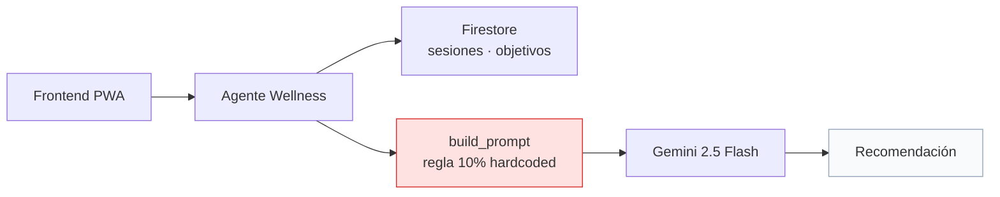
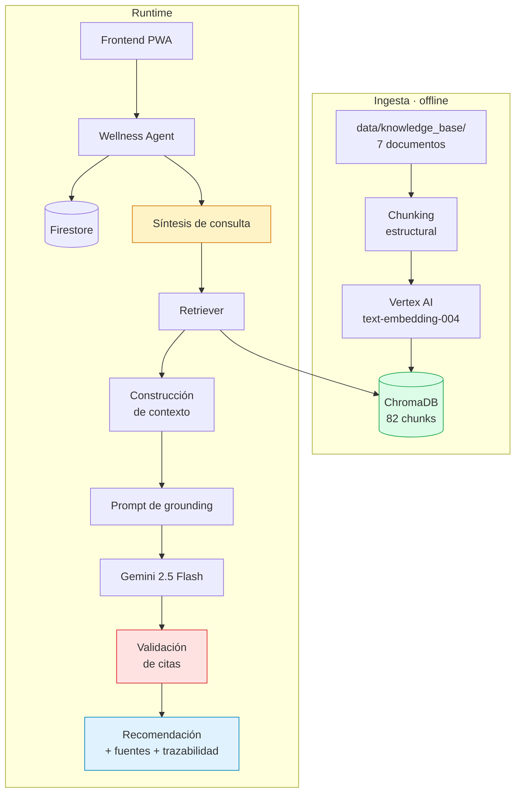

# Arquitectura del Sistema RAG

**Sprint 1 — Ingeniería del Conocimiento y Sistemas RAG**
Plataforma Inteligente Wellness 2.0 · Equipo 1

---

## 1. Punto de partida y transformación

### Arquitectura previa al sprint

El agente desarrollado en la asignatura de Ingeniería del Software y Bases de Datos operaba con conocimiento embebido en el código:



**Limitaciones:**

- El único conocimiento de dominio era una regla codificada rígidamente
- Gemini respondía desde su conocimiento paramétrico, sin fuentes verificables
- No existía base de conocimiento, ontología ni recuperación semántica
- Ninguna recomendación era trazable a fundamento alguno

### Arquitectura resultante



---

## 2. Componentes

| Componente | Módulo | Responsabilidad |
|---|---|---|
| Chunker | `src/knowledge/chunking/chunker.py` | Fragmentación estructural con propagación de metadata |
| Embedder | `src/rag/embeddings/embedder.py` | Vectorización con diferenciación por `task_type` |
| Vector store | `src/rag/vector_store/store.py` | Persistencia, búsqueda, idempotencia |
| Retriever | `src/rag/retriever/retriever.py` | Recuperación top-k con filtrado por metadata |
| Pipeline | `src/rag/pipeline/rag_pipeline.py` | Orquestación, síntesis de consulta, validación |
| Generator | `src/rag/generation/generator.py` | Invocación a Gemini con salida estructurada |
| Agente | `src/agents/wellness/agent.py` | Modo dual, acceso a datos, persistencia |
| Ingesta | `scripts/ingestion/index_knowledge_base.py` | Indexación idempotente |
| Evaluación | `scripts/evaluation/evaluate_retrieval.py` | Métricas sobre conjunto de referencia |

---

## 3. Flujo de ingesta

Proceso offline, ejecutado únicamente al modificar la knowledge base.

```
[1] Chunking                    82 chunks desde 7 documentos
[2] Generación de embeddings    4 lotes por presupuesto de tokens
[3] Eliminación de versiones    por doc_id
[4] Inserción                   con IDs deterministas
```

**El orden es deliberado.** Los embeddings se generan antes de modificar el estado persistente, porque son el paso que puede fallar. Una versión previa invertía los pasos 2 y 3: al fallar la generación por exceso de tokens, la colección quedaba vaciada sin reemplazo.

**Idempotencia** garantizada por identificadores deterministas —hash del contenido— y reemplazo selectivo por documento.

---

## 4. Flujo de runtime

```
Estado del corredor
  ├─ sesiones (Firestore)
  ├─ carga semanal actual y previa
  ├─ objetivos activos
  └─ nivel (perfil de usuario)
        ↓
  Síntesis de consulta          ← construir_consulta()
        ↓
  Embedding de consulta         ← task_type=RETRIEVAL_QUERY
        ↓
  Búsqueda top-3                ← ChromaDB, espacio coseno
        ↓
  Construcción de contexto      ← doc_id + evidencia + similitud
        ↓
  Prompt de grounding           ← 8 instrucciones de anclaje
        ↓
  Gemini 2.5 Flash              ← temperatura 0.2, salida JSON
        ↓
  Validación de citas           ← validar_fuentes()
        ↓
  Recomendación + trazabilidad
```

---

## 5. Decisiones arquitectónicas

### 5.1 Stack mínimo sobre framework completo

Se descartó `langchain-google-vertexai` en favor de `langchain-text-splitters` más los SDK nativos de Vertex AI y ChromaDB.

**Motivación inmediata:** conflicto irresoluble de dependencias. `firebase-admin 7.4.0` requiere `google-cloud-storage >= 3.1.1`; `langchain-google-vertexai 2.0.28` requiere `< 3.0.0`.

**Motivación de fondo:** el paquete envolvía un SDK ya instalado y operativo en el proyecto. Eliminarlo redujo el árbol de dependencias y aumentó la transparencia de las llamadas.

Se conserva `langchain-text-splitters` para la fragmentación, que es donde LangChain aporta valor real en este pipeline.

### 5.2 ChromaDB sobre FAISS

Persistencia nativa, filtrado por metadata integrado e inspeccionabilidad. La ventaja de rendimiento de FAISS es irrelevante a escala de 82 fragmentos.

### 5.3 Modo dual con endpoint comparativo

`analyze(mode="legacy"|"rag")` más `POST /compare`. Excede lo requerido por el sprint; se incorporó para permitir comparación empírica directa entre arquitecturas.

### 5.4 Consultas Firestore sin índices compuestos

Firestore exige índices compuestos al combinar `where` con `order_by` o múltiples `where` sobre campos distintos. Se optó por filtrar únicamente por `userId` y resolver ordenación y filtros temporales en memoria.

Con decenas de documentos por usuario el coste es despreciable, y elimina una dependencia de configuración manual en la consola de GCP.

### 5.5 Validación programática de citación

Documentada en `docs/rag/retrieval-pipeline.md`, sección 7. El prompt reduce la frecuencia del error; solo el código lo garantiza.

---

## 6. Integración con la plataforma

### API

```
POST /agent/{userId}/analyze?mode=rag       Recomendación con RAG (por defecto)
POST /agent/{userId}/analyze?mode=legacy    Recomendación con arquitectura previa
POST /agent/{userId}/compare                Ambas arquitecturas, sin persistir
GET  /agent/{userId}/recommendation         Última recomendación
GET  /agent/{userId}/recommendations        Historial
GET  /agent/{userId}/alerts                 Alertas activas
```

### Persistencia

Las recomendaciones se almacenan en la colección `recommendations` de Firestore, incorporando los campos nuevos (`modo`, `latenciaMs`, `fuentes`, `fundamento`, `confianza`).

La metadata de trazabilidad `_rag` **no se persiste**: es voluminosa y su valor reside en la inspección en vivo y la evaluación.

### Compatibilidad con el frontend

El esquema de respuesta conserva los campos del modo legacy (`tipo`, `mensaje`, `alerta`, `prioridad`), añadiendo los nuevos. El frontend existente sigue operando sin modificación; los campos adicionales quedan disponibles para su explotación en sprints posteriores.

---

## 7. Infraestructura

| Recurso | Configuración |
|---|---|
| Proyecto GCP | `runcoach-ai-496921` |
| Región | `us-central1` |
| Modelo generativo | `gemini-2.5-flash` (Vertex AI) |
| Modelo de embeddings | `text-embedding-004` (Vertex AI, 768 dim) |
| Base de datos | Cloud Firestore |
| Autenticación | Firebase Auth |
| Base vectorial | ChromaDB embebido, persistido en repositorio |
| Runtime | Python 3.11, FastAPI, Uvicorn |

**Nota sobre credenciales.** El proyecto se declara explícitamente en `firestore_client.py`. Sin esta declaración, `firebase-admin` adopta el proyecto por defecto de las credenciales ADC, que puede no ser el correcto — incidencia observada durante el desarrollo.

---

## 8. Deuda técnica identificada

| Elemento | Descripción |
|---|---|
| Configuración dispersa | `GCP_PROJECT` está declarado en cuatro módulos. Corresponde centralizar en `src/utils/config.py` con lectura de variables de entorno |
| SDK deprecado | `vertexai.language_models` y `vertexai.generative_models` anuncian retirada para junio de 2026. Migración a `google-genai` pendiente |
| Índice versionado en Git | `data/vector_store/` contiene binarios versionados. Aceptable a esta escala, no escalable |
| Sin pruebas automatizadas | Los directorios `tests/` permanecen vacíos |
| ChromaDB embebido | No apto para despliegue multi-instancia sin volumen compartido |
| Brecha ontología / datos | `Objetivo` se modela con fecha meta; la implementación usa metas de volumen |

---

## 9. Evolución prevista

**Sprint 2 — Agentes Inteligentes.** El `BaseAgent` abstracto y la separación de responsabilidades del pipeline permiten incorporar memoria conversacional, tool calling y el patrón ReAct sin reestructurar la capa de conocimiento.

**Sprint 3 — Sistemas Multiagente.** El filtrado por categoría del retriever está diseñado para que cada agente especializado —nutrición, motivación, analítica— consulte únicamente su dominio de conocimiento sobre la misma base vectorial.

**Módulo de gestión documental.** El pipeline idempotente y dirigido por metadata admite una capa de API e interfaz para carga y reindexación de documentos sin modificación del núcleo.
