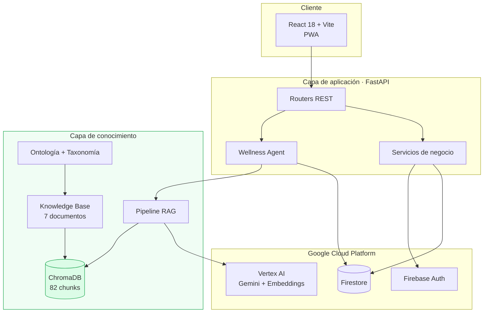

# Visión General del Sistema

**Plataforma Inteligente Wellness 2.0 — Equipo 1**
Sistemas Inteligentes · Maestría en TIC · Universidad del Zulia

---

## 1. Propósito

Plataforma de gestión de entrenamiento de resistencia con recomendaciones generadas por inteligencia artificial y fundamentadas en conocimiento especializado curado.

La plataforma evoluciona de un sistema cloud-native con un agente de IA —construido en Ingeniería del Software y Bases de Datos— hacia un sistema inteligente basado en conocimiento, con agentes especializados y orquestación multiagente.

---

## 2. Arquitectura general



La **capa de conocimiento** es la incorporación del Sprint 1. En la arquitectura previa el agente invocaba directamente a Vertex AI sin conocimiento externo interpuesto.

---

## 3. Componentes

### Cliente

PWA en React 18 con Vite y TailwindCSS. Gestiona registro de sesiones, definición de objetivos, visualización de progreso y consulta de recomendaciones.

### Capa de aplicación

FastAPI con separación por responsabilidades:

| Módulo | Responsabilidad |
|---|---|
| `src/app/main.py` | Punto de entrada, CORS, registro de routers |
| `src/api/routes/` | Endpoints REST |
| `src/agents/wellness/` | Agente de entrenamiento con modo dual |
| `src/services/` | Lógica de negocio (autenticación) |
| `src/database/` | Cliente Firestore |
| `src/utils/` | Construcción de prompts y utilidades compartidas |

### Capa de conocimiento

| Módulo | Responsabilidad |
|---|---|
| `src/knowledge/ontology/` | Modelo conceptual del dominio |
| `src/knowledge/taxonomy/` | Vocabulario controlado |
| `src/knowledge/chunking/` | Fragmentación estructural |
| `src/rag/embeddings/` | Vectorización |
| `src/rag/vector_store/` | Persistencia y búsqueda vectorial |
| `src/rag/retriever/` | Recuperación semántica |
| `src/rag/pipeline/` | Orquestación del flujo RAG |
| `src/rag/generation/` | Invocación al modelo generativo |
| `src/evaluation/` | Métricas de evaluación |

### Servicios cloud

| Servicio | Uso |
|---|---|
| Cloud Firestore | Usuarios, sesiones, objetivos, recomendaciones |
| Firebase Auth | Autenticación |
| Vertex AI | Gemini 2.5 Flash y `text-embedding-004` |
| Firebase Hosting | Despliegue del frontend |
| Cloud Run | Despliegue del backend |

---

## 4. Modelo de datos

### Colecciones de Firestore

| Colección | Campos principales |
|---|---|
| `users` | `uid`, `email`, `nombre`, `edad`, `peso`, `nivel` |
| `sessions` | `userId`, `fecha`, `distanciaKm`, `tipo` |
| `goals` | `userId`, `kmMeta`, `tipo`, `activo` |
| `recommendations` | `userId`, `tipo`, `mensaje`, `alerta`, `prioridad`, `modo`, `fuentes`, `fundamento`, `confianza` |

Los cuatro últimos campos de `recommendations` son aportación del Sprint 1.

### Consideración sobre consultas

Se evita deliberadamente combinar `where` con `order_by`, y usar múltiples `where` sobre campos distintos, porque Firestore exige índices compuestos en esos casos. El filtrado se realiza por `userId` y el resto se resuelve en memoria.

---

## 5. Flujo de recomendación

```
Usuario solicita recomendación
        ↓
Agente carga estado desde Firestore
  sesiones · carga semanal · objetivos · nivel
        ↓
Síntesis de consulta en lenguaje natural
        ↓
Recuperación top-3 sobre ChromaDB
        ↓
Construcción de contexto con procedencia y evidencia
        ↓
Generación con Gemini bajo prompt de grounding
        ↓
Validación programática de citas
        ↓
Persistencia en Firestore + respuesta con trazabilidad
```

Detalle en `docs/architecture/rag-architecture.md`.

---

## 6. API

```
POST /agent/{userId}/analyze?mode=rag       Recomendación con RAG (por defecto)
POST /agent/{userId}/analyze?mode=legacy    Recomendación con arquitectura previa
POST /agent/{userId}/compare                Ambas arquitecturas, comparativa
GET  /agent/{userId}/recommendation         Última recomendación
GET  /agent/{userId}/recommendations        Historial
GET  /agent/{userId}/alerts                 Alertas activas
POST /auth/register                         Registro de usuario
GET  /auth/user/{uid}                       Perfil
PUT  /auth/user/{uid}                       Actualización de perfil
GET  /health                                Estado del servicio
```

---

## 7. Stack tecnológico

| Capa | Tecnología |
|---|---|
| Frontend | React 18, Vite, TailwindCSS, PWA |
| Backend | Python 3.11, FastAPI, Uvicorn |
| Conocimiento | `langchain-text-splitters`, ChromaDB, PyYAML |
| IA | Gemini 2.5 Flash, `text-embedding-004` (Vertex AI) |
| Datos | Cloud Firestore |
| Infraestructura | GCP: Cloud Run, Firebase Hosting, Firebase Auth |
| Documentación | Markdown, Mermaid |

---

## 8. Estado por sprint

| Sprint | Tema | Estado |
|---|---|---|
| Sprint 1 | Ingeniería del Conocimiento y RAG | ✅ Completado |
| Sprint 2 | Agentes Inteligentes Modernos | Pendiente |
| Sprint 3 | Sistemas Multiagente | Pendiente |

### Preparación para sprints posteriores

**Sprint 2.** `BaseAgent` está definido como clase abstracta con contrato `analyze()` y `build_prompt()`. La capa de conocimiento es independiente de la lógica del agente, lo que permite incorporar memoria conversacional, tool calling y patrón ReAct sin reestructuración.

**Sprint 3.** Los directorios `src/agents/{nutrition,motivation,analytics}/` y `src/orchestration/` están creados. El filtrado por categoría del retriever permite que cada agente especializado consulte únicamente su dominio de conocimiento sobre la misma base vectorial.

---

## 9. Documentación relacionada

| Documento | Contenido |
|---|---|
| `docs/architecture/rag-architecture.md` | Arquitectura detallada del sistema RAG |
| `docs/knowledge/domain-map.md` | Mapa del dominio wellness |
| `docs/knowledge/ontology.md` | Modelo conceptual |
| `docs/knowledge/taxonomy.md` | Vocabulario controlado |
| `docs/rag/` | Estrategias de chunking, embeddings, vector store y recuperación |
| `docs/evaluation/` | Métricas, casos de prueba y calidad de respuestas |
| `docs/reports/sprint-1-report.md` | Informe del sprint |
| `docs/deployment/local-setup.md` | Instalación y ejecución |
