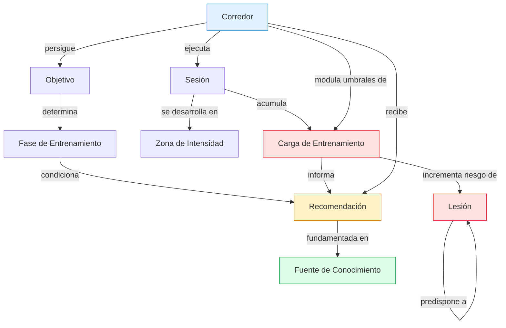
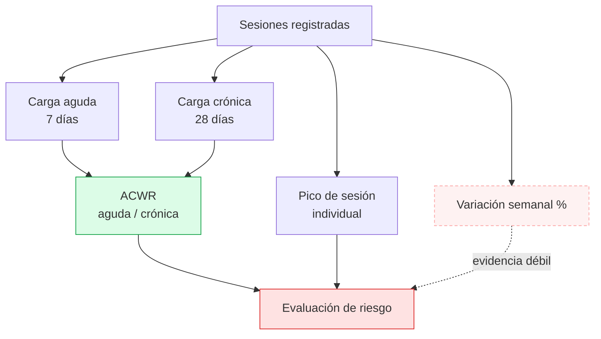

# Mapa de Conocimiento del Dominio Wellness

**Sprint 1 — Ingeniería del Conocimiento y Sistemas RAG**
Plataforma Inteligente Wellness 2.0 · Equipo 1

---

## 1. Delimitación del dominio

El dominio modelado es el **entrenamiento de resistencia aplicado a la carrera a pie**, acotado a la toma de decisiones sobre carga, intensidad y recuperación de un corredor individual.

Se incluye dentro del alcance:

- Cuantificación y progresión de la carga de entrenamiento
- Clasificación fisiológica de la intensidad
- Distribución de intensidad a lo largo del macrociclo
- Prevención de lesiones por sobreuso asociadas a errores de carga
- Puesta a punto previa a competición
- Soporte nutricional y de recuperación

Queda fuera del alcance el diagnóstico clínico, la prescripción de tratamiento de lesiones establecidas y la biomecánica instrumentada.

---

## 2. Modelo conceptual

La relación `Recomendación → fundamentada en → Fuente de Conocimiento` es la que materializa el aporte de RAG. En la arquitectura previa esa arista no existía: las recomendaciones se generaban sin trazabilidad a conocimiento curado.

---

## 3. Jerarquía de conceptos

### 3.1 Eje de intensidad

La intensidad se organiza alrededor de dos umbrales fisiológicos de lactato:

| Umbral | Definición | Zonas asociadas |
|--------|-----------|-----------------|
| **LT1** | Primer umbral de lactato. Punto en que la lactatemia comienza a elevarse sobre el nivel basal | Z1, Z2 quedan por debajo |
| **LT2** | Segundo umbral. Velocidad más lenta que produce un incremento súbito y sostenido de lactato | Z5 queda por encima |

La asignación de zonas mediante porcentajes de frecuencia cardíaca es una aproximación. La variabilidad interindividual en la FC correspondiente a LT1 y LT2 es sustancial, por lo que los rangos de la taxonomía son referenciales.

### 3.2 Eje temporal

### 3.3 Eje de carga

La arista discontinua señala que la variación porcentual semanal — base de la clásica regla del 10% — tiene soporte de evidencia sustancialmente más débil que el ACWR y el control de picos de sesión individual.

---

## 4. Fuentes de conocimiento por categoría

| Categoría | Documento KB | Nivel de evidencia predominante |
|-----------|--------------|--------------------------------|
| Carga de entrenamiento | `carga-entrenamiento-progresion.md` | Moderado / Práctica consolidada |
| Zonas fisiológicas | `zonas-intensidad-umbrales.md` | Alto |
| Distribución de intensidad | `distribucion-intensidad-polarizado.md` | Alto |
| Prevención de lesiones | `prevencion-lesiones-sobreuso.md` | Moderado |
| Tapering | `tapering-puesta-a-punto.md` | Alto |
| Nutrición | `nutricion-corredor.md` | Alto |
| Recuperación | `recuperacion-sueno.md` | Moderado |

---

## 5. Conocimiento simbólico explícito

Además del conocimiento documental recuperable vía RAG, el modelo declara cinco axiomas de inferencia en la ontología (`AX-01` a `AX-05`). Representan reglas de decisión que el agente aplica de forma determinista, complementando la recuperación semántica.

Esta convivencia entre **representación simbólica** (axiomas, taxonomía) y **representación distribuida** (embeddings, recuperación semántica) es deliberada: el sistema no sustituye una por la otra sino que las articula.

---

## 6. Caso testigo: la regla del 10%

El sistema previo a este sprint codificaba de forma rígida la regla del 10% — no incrementar el volumen semanal más de un 10% respecto a la semana anterior. Esta regla es un caso instructivo de **práctica consolidada sin respaldo fuerte**:

- No procede de un estudio fundacional; se popularizó en literatura de divulgación de los años 80
- Un estudio con 486 corredores novatos no encontró diferencia en la incidencia de lesión entre un programa con incrementos graduados al 10% y un programa estándar
- Análisis posteriores no hallaron diferencia entre incrementos del 10% y del 24%
- La regla trata todo volumen como equivalente, ignorando que 10% más de rodaje suave no impone el mismo estrés que 10% más de trabajo de calidad

La knowledge base documenta la regla, su origen, la evidencia que la cuestiona y las alternativas mejor sustentadas (ACWR, control de picos de sesión individual, modulación por nivel del corredor). Este caso se emplea como demostración del contraste entre el flujo *legacy* y el flujo *RAG*.

---

## Referencias

Ver `docs/rag/knowledge-sources.md` para el detalle completo de fuentes consultadas por documento.
