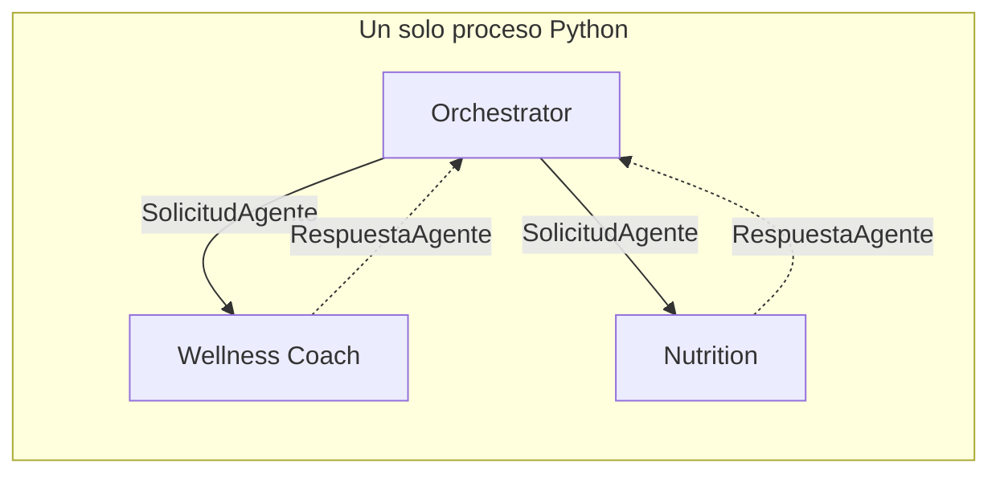

# A2A — Agent-to-Agent

**Sprint 3 — Sistemas Multiagente** · Plataforma Inteligente Wellness 2.0 · Equipo 1

Análisis arquitectónico de cómo el sistema evolucionaría hacia A2A. **No se
implementa en este sprint**, conforme al alcance del issue S3-04, que plantea
considerar estos mecanismos *«arquitectónicamente, sin requerir una
implementación completa»*.

Para el acceso a capacidades, ver `mcp.md`. **No compiten**: A2A mira hacia los
lados, a cómo los agentes se hablan entre sí; MCP mira hacia abajo, a cómo
alcanzan sus herramientas.

---

## 1. Dónde está hoy el sistema

Los tres agentes viven en el mismo proceso Python. Una delegación es una llamada
de función a través del invocador registrado en `registro_agentes.py`, y el
intercambio está tipado por `SolicitudAgente` y `RespuestaAgente`.

Eso significa que **el sistema ya tiene una frontera de comunicación explícita**,
aunque no la cruce por red. Es la diferencia entre tener que diseñar un
protocolo desde cero y tener que serializar uno que ya existe.

---

## 2. El mapeo del contrato actual

`SolicitudAgente` y `RespuestaAgente` pasarían de ser dataclasses en memoria a
mensajes serializados sobre un transporte. El mapeo es casi directo:

| Campo actual | Equivalente A2A |
|---|---|
| `traza_id` | Identificador de correlación de la conversación |
| `user_id` | Contexto de identidad, propagado con autorización explícita |
| `mensaje` | Contenido de la tarea |
| `intencion` | Capacidad solicitada |
| `contexto` | Historial de la tarea |
| `paso` | Número de secuencia |
| `RespuestaAgente.degradado` | Estado de la tarea: completada con degradación |

**Que el mapeo sea tan directo no es casualidad: es la consecuencia de haber
definido el contrato explícitamente en S3-04** en lugar de seguir pasando
diccionarios sueltos. Ese trabajo, que en su momento se hizo por claridad
interna, es el que haría barata esta migración.

---

## 3. Qué está ya preparado

### 3.1 El descubrimiento tiene dónde apoyarse

A2A define *agent cards*: descripciones publicadas de qué sabe hacer cada
agente. El registro ya contiene exactamente esa información —`nombre`,
`titulo`, `descripcion`, `intencion`— y se usa para generar el catálogo del
clasificador. **Un agent card sería esa misma entrada serializada.**

### 3.2 La topología es compatible

El patrón Supervisor mapea sobre el modelo cliente-servidor de A2A sin
violencia: el orquestador es cliente, los especializados son servidores de
tareas.

### 3.3 No hay ciclos que resolver

Los agentes no delegan entre sí, así que no habría que diseñar detección de
ciclos distribuida — el problema más incómodo de un sistema A2A con delegación
horizontal. Ver `delegation-rules.md`, sección 4.

---

## 4. Qué habría que construir

### 4.1 Autenticación y autorización entre agentes

**Es el cambio más importante y el menos trivial.**

Hoy el `user_id` viaja en la solicitud y se confía en él porque el orquestador
lo inyecta desde el mismo proceso. Esa es la garantía de que un mensaje del
usuario no puede inducir a consultar datos de otro corredor, y hoy es
**estructural**: no depende de una validación que alguien pueda olvidar.

Entre servicios haría falta un token que acredite que el orquestador tiene
derecho a pedir datos de ese corredor, y la garantía pasaría a depender de la
autorización. Es un cambio de naturaleza, no de implementación.

### 4.2 El resto

- Tareas asíncronas y de larga duración, que A2A contempla y aquí no existen.
- Reintentos y tolerancia a fallos de red, hoy deliberadamente ausentes.
- Versionado de los contratos, porque dos servicios se despliegan por separado y
  pueden quedar desalineados.

---

## 5. Cuándo convendría

A2A tiene sentido cuando los agentes **pertenecen a dominios de despliegue o de
propiedad distintos**: equipos que liberan por separado, o agentes de terceros.

Con dos agentes del mismo equipo en el mismo repositorio, introduce
autenticación, versionado y fallos de red a cambio de nada.

Convendría si:

- La plataforma incorporara un **agente de un proveedor externo** — por ejemplo
  un servicio de nutrición clínica.
- Los agentes de **motivación y analítica** del roadmap los mantuviera otro
  equipo con su propio ciclo de despliegue.

---

## 6. Recomendación

**No adoptar A2A en el estado actual**, y en caso de adoptar ambos, **después de
MCP**: A2A implica propagar la identidad del corredor entre servicios, que es la
superficie de seguridad más delicada del sistema.

El trabajo hecho en S3-04 es, en la práctica, la preparación para esta
migración. Definir el contrato explícitamente, centralizar el despacho, mantener
el registro declarativo y correlacionar por `traza_id` son exactamente las
piezas que haría falta serializar. **La distancia entre este sistema y uno
interoperable es de transporte y seguridad, no de diseño.**

---

## 7. Estado en el repositorio

`src/orchestration/communication/a2a/` permanece vacío **a propósito**. Crear
estructura para algo que no se va a construir en este sprint solo produciría la
impresión de un avance que no existe.
