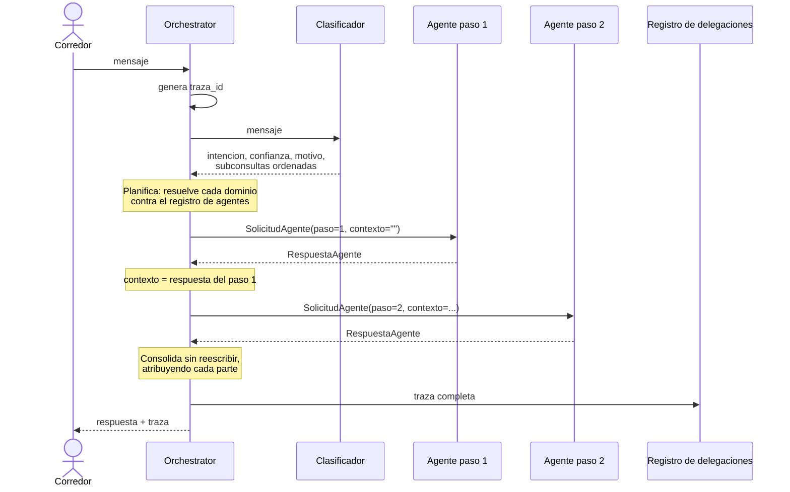

# Flujo de Comunicación entre Agentes

**Sprint 3 — Sistemas Multiagente** · Plataforma Inteligente Wellness 2.0 · Equipo 1

Especifica qué información acompaña a una delegación y qué información vuelve.
Implementado en `src/orchestration/communication/contratos.py`.

---

## 1. Qué es y qué no es este contrato

Los agentes viven en el mismo proceso: una delegación es una llamada de función,
no una petición de red. Este documento **no especifica un transporte**.

Lo que especifica es la **forma del intercambio**, y eso importa por dos
razones. La primera es que un contrato explícito es lo que permite que el
orquestador no conozca la forma interna de cada agente. La segunda es que, si
algún día estos agentes se separan en servicios distintos, lo que habría que
serializar es exactamente esto — ver `a2a.md`.

Hasta S3-03 la comunicación usaba diccionarios sueltos: cada adaptador devolvía
las claves que le parecían y el orquestador confiaba en que estuvieran. Funciona
con dos agentes y se vuelve frágil con más, porque nada declara qué debe viajar
ni qué puede faltar.

---

## 2. `SolicitudAgente` — del orquestador al agente

| Campo | Tipo | Qué lleva |
|---|---|---|
| `traza_id` | `str` | Identificador de la solicitud completa del corredor |
| `user_id` | `str` | Corredor que la origina |
| `mensaje` | `str` | Lo que se le pide a **este** agente |
| `intencion` | `str` | Dominio que atiende esta delegación |
| `contexto` | `str` | Lo que respondió el agente anterior, si lo hubo |
| `paso` | `int` | Posición dentro del flujo, empezando en 1 |

**`traza_id` es el mismo para todas las delegaciones de un mensaje.** Un flujo
con dos agentes produce dos solicitudes con el mismo `traza_id` y distinto
`paso`, de modo que el recorrido completo se reconstruye correlacionando por ese
campo.

**`user_id` no proviene del modelo.** Lo inyecta el orquestador desde el
contexto de la petición HTTP. Es la misma decisión que el Sprint 2 tomó para
`despachar()`: elimina **por construcción** la posibilidad de que un mensaje del
usuario induzca a consultar datos de otro corredor. No depende de una
validación que alguien pueda olvidar.

**`mensaje` es la parte que le toca**, no la consulta entera. Ver
`delegation-rules.md`, sección 3.

### 2.1 Cómo llega el contexto al agente

El contexto se **antepone al mensaje** en vez de pasarse por un parámetro
aparte, porque los agentes existentes reciben un único texto: el Wellness Coach
viene del Sprint 2 con la firma `conversar(user_id, mensaje)`, y cambiarla
obligaría a tocar su ciclo ReAct, sus pruebas y el script de evaluación por una
razón que no es suya.

El bloque que se antepone instruye explícitamente al segundo agente a
complementar sin repetir ni invadir el dominio del primero.

> **Limitación.** Funciona con dos agentes. Con más, el prompt del último
> crecería sin control. Un parámetro `contexto` en cada agente sería la
> solución, y queda anotada para cuando el roster crezca.

---

## 3. `RespuestaAgente` — del agente al orquestador

| Campo | Tipo | Qué lleva |
|---|---|---|
| `agente` | `str` | Quién respondió |
| `texto` | `str` | La respuesta en lenguaje natural |
| `herramientas_invocadas` | `list[str]` | Para trazabilidad |
| `fuentes` | `list[str]` | `doc_id` realmente recuperados |
| `degradado` | `bool` | Si alguna capacidad falló |
| `detalle` | `dict` | Información específica del agente |
| `latencia_ms` | `int` | Lo que tardó este agente |

Dos campos tienen semántica que conviene fijar por escrito, porque de otro modo
se interpretan mal al leer una traza:

**`herramientas_invocadas` vacía no significa dato ausente.** El Nutrition Agent
no usa tool calling por diseño: recupera y responde en una sola llamada. Su
trazabilidad viaja en `fuentes`.

**`degradado` significa que una capacidad falló**, no que la respuesta sea
pobre. Que la knowledge base no cubra una pregunta no es degradación. Ver
`delegation-rules.md`, sección 5.1.

### 3.1 Asimetría conocida en `fuentes`

El Wellness Coach **no expone sus fuentes de forma estructurada**. Cita los
`doc_id` dentro de su prosa, gobernado por las reglas de citación de su prompt,
pero su contrato de salida —heredado del ciclo ReAct del Sprint 2— no las
devuelve como lista. Por eso `fuentes` llega vacía desde ese agente, y no porque
no haya citado nada.

Cuantificado en la evaluación de S3-06: **en tres de doce casos el Coach se
fundamentó en la base de conocimiento y no pudo declarar una sola fuente**,
mientras el Nutrition Agent sí las reporta.

La consecuencia práctica es que una evaluación de fidelidad automatizada solo
podría cubrir a uno de los dos agentes. Corregirlo exige cambiar el contrato de
salida del ciclo ReAct.

---

## 4. Flujo completo de una delegación colaborativa



---

## 5. Manejo de fallos durante el intercambio

La invocación se protege **en el punto de despacho**, no en cada agente. Es la
misma decisión que la corrección S2-04 tomó un nivel más abajo para las
herramientas.

En un flujo colaborativo esto importa más: si el primer agente falla, **el
segundo se invoca igual** y el corredor recibe la mitad que sí funcionó,
declarada como tal, en vez de perder la consulta entera. El valor de degradar no
está en no caerse: está en conservar lo que sí funcionó.

| Situación | Comportamiento |
|---|---|
| Un agente lanza excepción | Respuesta degradada para ese paso; el flujo continúa |
| Los dos agentes fallan | Dos respuestas degradadas; la traza lo refleja |
| El clasificador falla | No se delega; se pide aclaración |
| Falla el registro de la traza | La solicitud se responde igual; el fallo va al log |

---

## 6. Registro de delegaciones

Cada solicitud produce **un documento** en la colección `delegaciones` de
Firestore, identificado por `traza_id`, con todos sus pasos. Un flujo con dos
agentes es un documento con dos pasos, no dos documentos: la unidad de análisis
es la solicitud, no la invocación.

Se persiste en lugar de solo loguear porque un log de servidor se pierde entre
reinicios, no se puede consultar desde la demo y obliga a tener acceso a la
máquina. Con la traza en Firestore, la evaluación puede recorrer una corrida
completa y la demo puede mostrar el recorrido de una solicitud sin abrir una
terminal.

Registrar es una operación auxiliar: si Firestore falla, la conversación
continúa. El corredor no tiene por qué quedarse sin respuesta porque no se pudo
escribir una traza.

---

## 7. Ejemplo completo

Traza real de una consulta mixta contra Vertex AI, ChromaDB y Firestore, tal
como quedó persistida:

```json
{
  "trazaId": "90ceb767-921c-4473-9fc0-81e656c6de0b",
  "intencion": "mixta",
  "dominios": ["nutricion", "entrenamiento"],
  "confianza": 0.95,
  "colaboracion": true,
  "agentes": ["nutrition", "wellness_coach"],
  "degradado": false,
  "pasos": [
    {
      "paso": 1,
      "agente": "nutrition",
      "mensajeDelegado": "Qué debo comer antes de una tirada larga?",
      "herramientasInvocadas": [],
      "fuentes": [],
      "latenciaMs": 6627
    },
    {
      "paso": 2,
      "agente": "wellness_coach",
      "mensajeDelegado": "Cómo debo ajustar mi entrenamiento esta semana, considerando que tengo una tirada larga?",
      "herramientasInvocadas": ["consultar_base_conocimiento"],
      "fuentes": [],
      "latenciaMs": 13936
    }
  ],
  "latencias": { "clasificacionMs": 5329, "agentesMs": 20563, "totalMs": 25893 }
}
```

---

## 8. Limitaciones del protocolo

| Limitación | Consecuencia | Estado |
|---|---|---|
| El contexto es un bloque de texto antepuesto | Con más de dos agentes el prompt del último crecería sin control | Anotado para cuando el roster crezca |
| El Coach no expone fuentes estructuradas | `fuentes` vacía desde ese agente; fidelidad medible solo en el otro | Medido en S3-06 |
| La delegación es secuencial | Dos agentes suman latencias: 26 s en el peor caso medido | Paralelizar exigiría renunciar al encadenamiento de contexto |
| No hay memoria compartida entre agentes | El contexto viaja por solicitud | Decisión de S3-01, no defecto |
| Sin reintentos ante fallo de un agente | Un fallo transitorio degrada el paso | Deliberado: reintentar duplicaría una latencia ya alta |

---

## 9. Documentos relacionados

| Tema | Documento |
|---|---|
| Política de delegación y reparto | `delegation-rules.md` |
| El componente orquestador | `orchestrator-agent.md` |
| Evolución a protocolos interoperables | `mcp.md`, `a2a.md` |
| Diagramas del flujo | `docs/architecture/orchestration-flow.md` |
