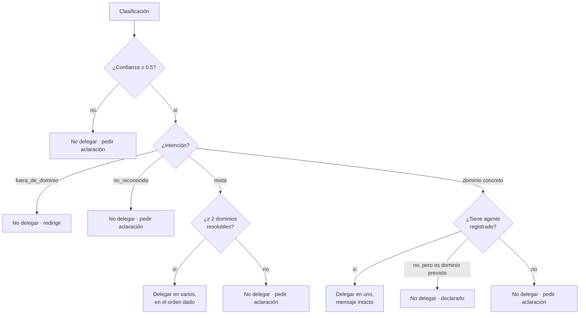

# Reglas de Delegación

**Sprint 3 — Sistemas Multiagente** · Plataforma Inteligente Wellness 2.0 · Equipo 1

La política completa de cuándo delegar, en quién, con qué mensaje y en qué
orden. Implementada en `OrchestratorAgent._planificar()`.

---

## 1. Dónde vive la política

Toda la decisión está en **una sola función pura**: `_planificar()` no toca red
ni modelo, recibe una clasificación y devuelve un plan.

Eso no es un detalle de implementación. El criterio de aceptación de S3-02 pide
que *«la delegación no dependa de reglas dispersas por diferentes
componentes»*, y una función que se lee entera de un vistazo y se prueba
exhaustivamente sin mockear nada es la forma más directa de cumplirlo.

---

## 2. El árbol de decisión

El **orden de las comprobaciones importa** y está fijado a propósito.



### 2.1 La confianza se evalúa primero, antes que la intención

Una intención clara pero poco confiable **no debe delegarse aunque tenga agente
disponible**. Una delegación equivocada entrega al corredor una respuesta del
dominio incorrecto sin avisarle de que hubo un error, lo cual es peor que una
pregunta de más.

### 2.2 Cinco motivos de no delegación

Cada uno produce un `motivoNoDelegacion` distinto en la traza:

| Motivo | Cuándo | Qué recibe el corredor |
|---|---|---|
| `confianza_insuficiente` | Confianza por debajo del umbral | Petición de aclaración |
| `fuera_de_dominio` | Tema ajeno a la plataforma | Redirección amable |
| `intencion_no_reconocida` | Mensaje ambiguo o incoherente | Petición de aclaración |
| `dominio_sin_agente` | Dominio de la plataforma sin agente asignado | Declaración honesta |
| `colaboracion_sin_agentes_suficientes` | Mixta que no resuelve dos agentes | Petición de aclaración |

**La distinción entre `fuera_de_dominio` y `dominio_sin_agente` importa.** Un
tema que la plataforma cubre pero que aún no tiene agente no debe tratarse como
ajeno: decirle al corredor que la plataforma no trata ese tema, cuando sí lo
trata, es decirle algo falso.

Al cerrar S3-03 la lista de dominios sin agente está vacía —la nutrición, su
única entrada, pasó a tener agente— pero el mecanismo se conserva para los
agentes de motivación y analítica que contempla el roadmap. Graduar un dominio
de una lista a la otra es el camino previsto para incorporarlos.

---

## 3. El reparto de consultas mixtas

Cuando intervienen dos dominios, **cada agente recibe una pregunta autónoma**,
no el mensaje completo.

### 3.1 Por qué, con la evidencia que lo motivó

La primera implementación de S3-04 entregaba el mensaje entero a los dos
agentes. La medición contra servicios reales mostró el problema:

> *Nutrition Agent:* «…En cuanto a cómo ajustar tu entrenamiento esta semana,
> **esa parte la gestiona el especialista en entrenamiento de la plataforma**…»
>
> *Wellness Coach, inmediatamente debajo:* «He echado un vistazo a tus
> sesiones…»

El corredor leía una derivación hacia alguien que le está respondiendo en la
misma pantalla. Cada agente respetaba su frontera correctamente; el problema era
que ambos veían una pregunta que no era enteramente suya.

### 3.2 Las tres reglas del reparto

1. **Autónoma.** Debe entenderse sin leer el mensaje original ni las otras
   partes, porque el agente solo verá la suya.
2. **Sin la parte ajena**, para no provocar la derivación redundante.
3. **Conservando los detalles relevantes aunque estén redactados en la otra
   parte.**

La tercera es la que hace que repartir mejore la respuesta en vez de empeorarla,
y no es teórica:

```
mensaje original
  "Que como antes de una tirada larga y como ajusto el entrenamiento esta semana?"

reparto
  nutrition      → "Qué debo comer antes de una tirada larga?"
  wellness_coach → "Cómo debo ajustar mi entrenamiento esta semana,
                    considerando que tengo una tirada larga?"
```

La tirada larga aparecía en la frase nutricional y se trasladó a la sub-consulta
de entrenamiento. Sin esa regla, el Coach habría respondido sin saber que hay
una tirada larga prevista.

### 3.3 Dónde se reparte

Lo hace el clasificador, no el orquestador. El clasificador ya está leyendo el
mensaje y decidiendo qué dominios intervienen; partirlo en el orquestador
exigiría una segunda llamada al modelo sobre el mismo texto.

### 3.4 El orden

El clasificador devuelve los dominios ordenados, y ese orden determina **quién
responde primero y cuya respuesta sirve de contexto al siguiente**. La
instrucción es poner primero lo específico y después lo general, de modo que el
segundo especialista pueda apoyarse en lo ya dicho sin repetirlo.

### 3.5 Si el reparto falla

Si el clasificador nombra un dominio válido pero deja su sub-mensaje vacío, se
usa el mensaje original en vez de descartar la delegación. **Un agente con la
pregunta entera responde de más; un agente al que no se invoca deja un hueco
silencioso en la respuesta**, que es peor.

Si declara `mixta` sin al menos dos dominios resolubles, la clasificación es
incoherente consigo misma —afirma que hacen falta varios especialistas y no
sabe nombrarlos— y se trata como no confiable. Adivinar a quién delegar sería
inventar.

---

## 4. Prevención de ciclos

Tres mecanismos, en orden de fuerza.

**1. Estructural: los agentes especializados no delegan.** Solo el orquestador
lo hace. Un agente que reciba algo fuera de su alcance lo declara en su
respuesta; no lo reenvía. No existe la delegación horizontal, así que no puede
haber un ciclo entre agentes.

**2. El plan es finito y se fija antes de empezar.** La lista de delegaciones se
determina en `_planificar()`, antes de invocar al primer agente. Ninguna
respuesta puede añadir pasos al plan en curso.

**3. Guarda explícita contra repetición.** `_ejecutar_plan()` lleva el conjunto
de agentes ya invocados y omite cualquier repetición, registrándola como error.
El clasificador además elimina dominios duplicados.

El tercer mecanismo no debería dispararse nunca dados los dos anteriores: existe
por si alguno se debilita en el futuro, y tiene prueba propia.

---

## 5. Los adaptadores: cómo se invoca a cada agente

Cada entrada del registro tiene un **invocador** que recibe una
`SolicitudAgente` y devuelve una `RespuestaAgente`. Es el único lugar del
sistema que conoce la forma concreta en que habla cada agente.

| Agente | Forma interna | Qué traduce el adaptador |
|---|---|---|
| Wellness Coach | claves camelCase del ciclo ReAct del Sprint 2 | `respuesta` → `texto`, `herramientasInvocadas` → lista de nombres |
| Nutrition | claves propias, sin tool calling | `fuentes` validadas, `cubierto` al detalle |

Sin esa traducción, cambiar el contrato interno de un agente obligaría a tocar
el orquestador.

### 5.1 Qué cuenta como degradación

Solo una capacidad que falla: un servicio caído, una consulta que no se pudo
completar, una fuente citada que nunca se recibió.

**Que la base de conocimiento no cubra una pregunta NO es degradación.** Es el
sistema funcionando: el agente comprobó que no alcanzaba y lo declaró en vez de
rellenarlo con conocimiento no verificado. Contarlo como fallo registraría la
conducta correcta igual que un error.

La primera versión del adaptador de nutrición las confundía. Se corrigió en
S3-03, y la evaluación de S3-06 lo validó: MA-11 devuelve `cubierto: false` con
`degradado: false`, y la corrida reporta cero degradaciones sobre una conducta
impecable. Con la versión original habría reportado una.

---

## 6. Consolidación de respuestas

Con un agente, su texto tal cual. Con varios, cada respuesta bajo una etiqueta
que indica quién la aportó, y **sin parafrasear**.

La razón no es de estilo. Las citas a la knowledge base se validan
programáticamente contra los fragmentos que recuperó cada agente
(`validar_fuentes()`, Sprint 1), y esa validación aplica al texto que el agente
produjo. Si el orquestador lo reescribiera, la correspondencia entre afirmación
y fuente dejaría de estar garantizada: **parafrasear rompería la trazabilidad
que sostiene todo el sistema.**

La contrapartida es que una respuesta colaborativa se lee como dos bloques y no
como un texto continuo. Se asume a cambio de la garantía.

El único texto propio del orquestador es un conector fijo que anuncia la
estructura sin afirmar nada del dominio.

---

## 7. Verificación

| Aspecto | Dónde |
|---|---|
| Política completa de `_planificar()` | `tests/unit/test_orchestrator.py::TestPlanificacion` |
| Reparto, orden, contexto encadenado, guarda de ciclos | `TestColaboracionEntreAgentes` |
| Filtrado de dominios y sub-mensajes | `TestClasificador` |
| Delegación correcta contra 12 casos reales | `scripts/evaluation/evaluate_multiagent.py` |

En la evaluación de S3-06: **100 % de delegación exacta (12/12)**, cero
sobredelegaciones, cero subdelegaciones, cero órdenes incorrectos.

---

## 8. Documentos relacionados

| Tema | Documento |
|---|---|
| Justificación del patrón | `orchestration-pattern.md` |
| El componente orquestador | `orchestrator-agent.md` |
| Contrato de mensajes | `communication-flow.md` |
| Diagramas del flujo | `docs/architecture/orchestration-flow.md` |
