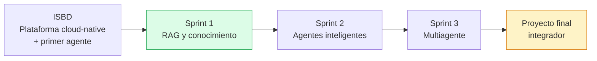

# Hoja de Ruta

**Plataforma Inteligente Wellness 2.0 — Equipo 1**
Sistemas Inteligentes · Maestría en TIC · Universidad del Zulia

---

## 1. Evolución del proyecto

---

## 2. Sprint 1 — Ingeniería del Conocimiento y RAG ✅

**Objetivo:** transformar el agente heredado en un sistema basado en conocimiento.

| Entregable | Estado |
|---|---|
| Modelo de conocimiento (ontología, taxonomía, mapa) | ✅ |
| Base de conocimiento curada | ✅ |
| Estrategias de chunking y embeddings | ✅ |
| Base vectorial | ✅ |
| Pipeline RAG completo | ✅ |
| Métricas de recuperación y casos de prueba | ✅ |
| Evaluación de calidad de respuestas | ⚠️ Parcial |

**Resultados:** Recall@3 de 0.944, MRR de 0.944 sobre 18 casos. 7 documentos, 82 fragmentos indexados.

**Adicional no requerido:** modo dual legacy/RAG con endpoint comparativo.

---

## 3. Sprint 2 — Agentes Inteligentes Modernos

**Objetivo:** dotar al agente de capacidad de razonamiento y uso de herramientas.

### Del programa

- Refactorización del Wellness Agent
- Diseño del Wellness Coach Agent 2.0: responsabilidades, herramientas, prompt especializado, flujo de razonamiento
- Memoria conversacional
- Integración de herramientas externas (tool calling)
- Patrón ReAct
- Evaluación del comportamiento del agente

### Derivado del Sprint 1

| Elemento | Prioridad |
|---|---|
| Evaluación de faithfulness y answer relevance con LLM evaluador | Alta |
| Pruebas automatizadas y de regresión sobre el conjunto de referencia | Alta |
| Evaluación de recuperación sobre consultas sintetizadas | Alta |
| Expansión de consulta para mitigar la brecha de registro lingüístico | Media |
| Extensión del modelo de objetivos para admitir fechas de competición | Media |
| Centralización de configuración en `src/utils/config.py` | Media |
| Migración de `vertexai` a `google-genai` | Media |
| Benchmark de latencia con N ejecuciones | Baja |
| Ampliación del conjunto de referencia a 40–50 casos | Baja |

---

## 4. Sprint 3 — Sistemas Multiagente

**Objetivo:** construir una plataforma multiagente coordinada.

- Diseño de la arquitectura multiagente
- Orchestrator Agent: recepción de solicitudes, decisión de delegación, coordinación del flujo
- Agentes especializados: Wellness Coach, Nutrition, Analytics, Motivation
- Comunicación entre agentes y delegación de tareas
- Integración con Firestore y BigQuery
- Evaluación del flujo multiagente

### Preparación ya realizada

- Directorios `src/agents/{nutrition,motivation,analytics}/` y `src/orchestration/` creados
- `BaseAgent` definido como clase abstracta
- Filtrado por categoría del retriever, que permite a cada agente consultar su dominio sobre la misma base vectorial
- Knowledge base con documentos de nutrición (KB-006) y recuperación (KB-007) ya curados

---

## 5. Backlog de producto

Elementos no vinculados a un sprint específico, ordenados por valor.

### Alto

| Elemento | Descripción |
|---|---|
| **Objetivos de competición** | Extender el modelo de objetivos con distancia y fecha meta. Habilita fase de entrenamiento, tapering y el axioma AX-04 |
| **Módulo de gestión documental** | Interfaz administrativa para cargar documentos y reindexar la knowledge base. El pipeline idempotente ya lo admite |
| **Visualización de fuentes en el frontend** | Exponer `fuentes`, `fundamento` y `confianza` en la interfaz. Los campos ya se persisten pero no se muestran |

### Medio

| Elemento | Descripción |
|---|---|
| **Registro de frecuencia cardíaca** | Habilita clasificación fiable por zona de intensidad y análisis de distribución |
| **Cálculo de ACWR** | Requiere 28 días de historial continuo. El conocimiento está en KB-001, falta la instrumentación |
| **Registro de sueño y percepción de esfuerzo** | Habilita el conocimiento de KB-007 sobre detección temprana de sobrecarga |
| **Análisis de distribución de intensidad** | Detección del patrón de deriva hacia Z3 documentado en KB-003 |

### Bajo

| Elemento | Descripción |
|---|---|
| **Búsqueda híbrida BM25 + semántica** | Robustez frente a brechas léxicas y semánticas |
| **Ampliación del corpus** | Entrenamiento de fuerza, factores psicológicos, condiciones ambientales |
| **Migración a servicio vectorial gestionado** | Necesario para despliegue multi-instancia |
| **Índice vectorial regenerado en despliegue** | Evita versionar binarios en el repositorio |

---

## 6. Deuda técnica

| Elemento | Impacto | Sprint objetivo |
|---|---|---|
| `GCP_PROJECT` duplicado en 4 módulos | Bajo | Sprint 2 |
| SDK Vertex AI deprecado (retirada junio 2026) | Medio | Sprint 2 |
| Directorios `tests/` vacíos | Alto | Sprint 2 |
| ChromaDB embebido, no apto multi-instancia | Medio | Sprint 3 |
| Índice vectorial versionado en Git | Bajo | Sprint 3 |
| Middleware JWT solo en el servicio de autenticación | Medio | Sprint 2 |
| Brecha entre ontología y modelo de datos de objetivos | Medio | Sprint 2 |

---

## 7. Proyecto final integrador

Integración de los tres sprints en una plataforma multiagente completa, con demostración funcional y documentación consolidada en `docs/reports/final-report.md`.
