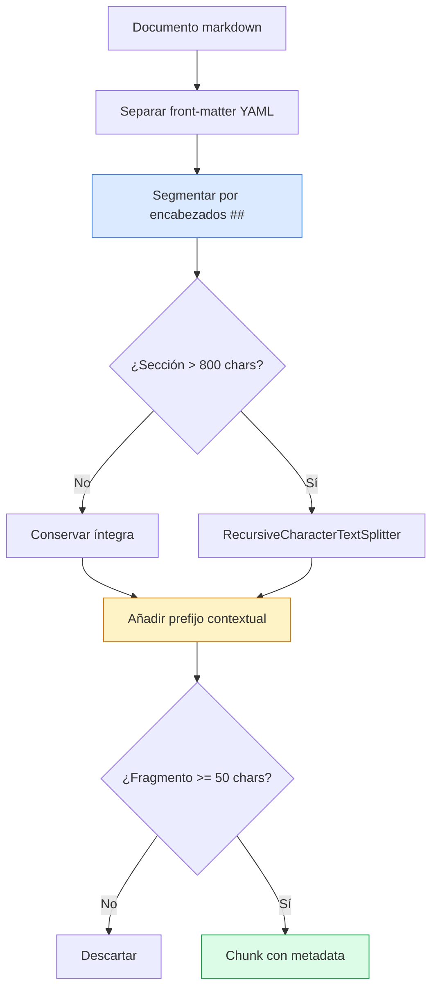

# Estrategia de Chunking

**Sprint 1 — Ingeniería del Conocimiento y Sistemas RAG**
Plataforma Inteligente Wellness 2.0 · Equipo 1

Implementación: [`src/knowledge/chunking/chunker.py`](../../src/knowledge/chunking/chunker.py)

---

## 1. Por qué fragmentar

Existen dos razones para dividir los documentos, y la segunda es la determinante.

**Razón evidente — límite de contexto.** El modelo generativo tiene una ventana finita. No es viable inyectar el corpus completo en cada consulta.

**Razón determinante — nitidez del vector.** Un embedding representa el *significado promedio* del texto que codifica. Un documento de 3.000 palabras que aborda carga interna, ACWR, la regla del 10 % y niveles de corredor produce **un único vector difuso**, promedio de todos esos temas. Cuando el usuario consulta específicamente sobre tapering, ese vector compite en desventaja frente a un fragmento de 200 palabras dedicado exclusivamente a tapering.

> Fragmentos pequeños producen vectores nítidos. Fragmentos grandes producen vectores difusos.

---

## 2. El compromiso fundamental

| Fragmento demasiado pequeño | Fragmento demasiado grande |
|---|---|
| Vector nítido, buena correspondencia | Vector difuso, correspondencia débil |
| Pierde contexto: *"esto se reduce un 41 %"* sin referente | Arrastra ruido al prompt |
| Fragmenta ideas por la mitad | Desperdicia ventana de contexto |
| Más fragmentos, más coste de indexación | Menos precisión en la recuperación |

No existe un valor universalmente óptimo. La configuración adecuada depende de la estructura del corpus.

---

## 3. Estrategia adoptada: híbrida consciente de la estructura

Los documentos de la knowledge base **ya poseen semántica estructural**: los encabezados `##` delimitan fronteras temáticas reales, definidas durante la curación. Ignorar esa estructura y segmentar cada N caracteres a ciegas desperdiciaría información disponible.

El algoritmo aplicado:



### 3.1 Segmentación primaria por encabezados

Cada sección delimitada por `##` constituye una unidad temática coherente. Los subencabezados `###` permanecen dentro de su sección padre, lo que preserva la jerarquía conceptual.

La implementación aprovecha que `re.split` con grupo de captura incluye lo capturado en el resultado:

```python
piezas = re.split(r"^## (.+)$", body, flags=re.MULTILINE)
# → [preámbulo, título1, cuerpo1, título2, cuerpo2, ...]
```

### 3.2 Subdivisión condicional

Una sección se subdivide **únicamente si excede el tamaño objetivo**. Segmentar por sistema destruiría coherencia sin beneficio: si una sección de 600 caracteres es temáticamente unitaria, partirla en dos produce dos vectores peores que uno.

Cuando la subdivisión es necesaria se emplea `RecursiveCharacterTextSplitter` con separadores en orden de preferencia:

```python
separators=["\n\n", "\n", ". ", " ", ""]
```

Intenta cortar en frontera de párrafo; si no cabe, en salto de línea; luego en punto; luego en espacio. La segmentación a mitad de palabra (`""`) es último recurso.

### 3.3 Prefijo contextual

Cada fragmento se antepone con la ruta documental:

```
[Tapering y puesta a punto para competición › Parámetros óptimos según la evidencia]

El metaanálisis de referencia estableció una reducción del 41 % al 60 %...
```

Esta técnica resuelve el problema clásico del chunking: **un fragmento aislado pierde su referente**. El texto *"se reduce entre 41 % y 60 %"* es inútil sin saber de qué. Con el prefijo:

- el **embedding** incorpora el contexto temático, mejorando la correspondencia semántica
- el **modelo generativo** sabe de qué documento y sección procede cada fragmento

Es una intervención de coste marginal —aproximadamente 75 caracteres por chunk— y efecto apreciable.

### 3.4 Filtro de fragmentos residuales

Se descartan fragmentos de menos de 50 caracteres. Son residuos de la segmentación sin valor semántico que solo introducen ruido en el índice.

**Corrección aplicada durante el desarrollo:** la versión inicial generaba un fragmento por documento que contenía únicamente el encabezado H1, procedente del preámbulo anterior al primer `##`. Esos fragmentos aparecían en resultados de recuperación ocupando posiciones útiles sin aportar contenido. La corrección elimina el encabezado H1 del preámbulo antes de evaluar el umbral:

```python
preambulo = re.sub(r"^#\s+.*$", "", piezas[0], flags=re.MULTILINE).strip()
if len(preambulo) >= 50:
    secciones.append(("Introducción", preambulo))
```

---

## 4. Parámetros y justificación

| Parámetro | Valor | Justificación |
|---|---|---|
| `CHUNK_SIZE` | 800 caracteres | ≈ 200 tokens en español. Suficiente para un subtema completo, contenido para mantener nitidez del vector |
| `CHUNK_OVERLAP` | 120 caracteres | 15 % del tamaño objetivo. Evita seccionar un concepto justo en la frontera |
| Umbral de descarte | 50 caracteres | Por debajo no hay contenido semántico útil |
| Separadores | `\n\n`, `\n`, `. `, ` `, `""` | Respeta fronteras naturales del texto en español |

### Sobre el solapamiento

El solapamiento de 120 caracteres garantiza que un concepto seccionado en la frontera aparezca íntegro en al menos uno de los fragmentos contiguos. El coste es duplicación parcial de contenido; el beneficio es evitar pérdida de información en los puntos de corte.

Un 15 % es un valor intermedio en el rango habitual (10–20 %). Valores superiores incrementan la redundancia del índice sin ganancia proporcional.

---

## 5. Resultados

```
carga-entrenamiento-progresion.md      → 13 chunks
distribucion-intensidad-polarizado.md  → 12 chunks
nutricion-corredor.md                  → 10 chunks
prevencion-lesiones-sobreuso.md        → 14 chunks
recuperacion-sueno.md                  → 11 chunks
tapering-puesta-a-punto.md             → 10 chunks
zonas-intensidad-umbrales.md           → 12 chunks
─────────────────────────────────────────────────
Total                                     82 chunks
```

| Indicador | Valor |
|---|---|
| Chunks totales | 82 |
| Media por documento | 11.7 |
| Tamaño medio | 608 caracteres |
| Mínimo | 127 caracteres |
| Máximo | 879 caracteres |

### Sobre el máximo de 879 caracteres

Supera el `CHUNK_SIZE` de 800 y no constituye un defecto. El prefijo contextual se añade **después** de la segmentación, sumando aproximadamente 75 caracteres. Una sección de 800 caracteres que no requiere subdivisión resulta en un chunk de ~875 tras la contextualización.

Se documenta explícitamente para evitar interpretaciones erróneas de la métrica.

### Sobre el mínimo de 127 caracteres

Corresponde a una sección breve que se conservó íntegra por estar por debajo del umbral de subdivisión. Es el comportamiento previsto: no había razón para fragmentarla.

---

## 6. Metadata propagada

Cada chunk incorpora metadata heredada del front-matter más información de posición:

```json
{
  "doc_id": "KB-001",
  "titulo": "Carga de entrenamiento y progresión del volumen",
  "categoria": "carga_entrenamiento",
  "nivel_evidencia": "moderado",
  "entidades_ontologia": "CargaEntrenamiento; Sesion; Corredor; Lesion",
  "conceptos_taxonomia": "niveles_corredor; tipos_sesion",
  "referencias": "Nielsen RO et al. ...; Gabbett TJ. ...",
  "archivo": "carga-entrenamiento-progresion.md",
  "seccion": "La regla del 10%: origen, adopción y evidencia",
  "chunk_index": 4
}
```

### Restricción de ChromaDB

ChromaDB admite en metadata únicamente `str`, `int`, `float` y `bool`. Los campos que en el front-matter son listas se aplanan con separador `"; "`:

```python
CAMPOS_LISTA = ["referencias", "entidades_ontologia", "conceptos_taxonomia"]
meta[campo] = "; ".join(str(v) for v in valor) if valor else ""
```

**Coste conocido:** el campo `referencias` ocupa ~700 caracteres y se replica en cada chunk del documento. A escala de 82 chunks el impacto es despreciable. En un corpus mayor correspondería normalizar, conservando únicamente `doc_id` en el chunk y resolviendo las referencias contra un registro documental externo. Se registra como decisión consciente.

---

## 7. Alternativas consideradas

| Estrategia | Evaluación |
|---|---|
| **Segmentación fija por caracteres** | Descartada. Ignora la estructura semántica disponible en el markdown |
| **Un chunk por documento** | Descartada. Produce vectores difusos y desperdicia ventana de contexto |
| **Segmentación por párrafo** | Descartada. Granularidad excesiva; párrafos aislados pierden referente |
| **Chunking semántico por similitud entre frases** | No adoptada en este sprint. Mayor coste computacional; el beneficio sobre un corpus con estructura explícita es marginal |
| **Híbrida por encabezados con subdivisión condicional** | **Adoptada** |

---

## 8. Limitaciones

**Tablas markdown.** `RecursiveCharacterTextSplitter` puede seccionar una tabla si la sección que la contiene excede el tamaño objetivo. Las tablas del corpus son compactas y no se ha observado el problema, pero es un riesgo latente ante documentos con tablas extensas.

**Solapamiento no aplicado entre secciones.** El solapamiento opera dentro de una sección subdividida, no entre secciones contiguas. Un concepto que atraviese la frontera de dos secciones `##` no queda cubierto. Se aceptó porque las fronteras de sección corresponden a cambios temáticos definidos durante la curación.

**Parámetros no optimizados empíricamente.** Los valores de 800/120 se fijaron por criterio informado, no por búsqueda sistemática. Una evaluación comparativa de configuraciones —midiendo su efecto sobre las métricas de recuperación— constituye trabajo pendiente.
