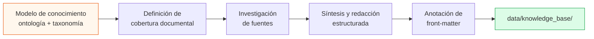

# Curación y Preparación Documental

**Sprint 1 — Ingeniería del Conocimiento y Sistemas RAG**
Plataforma Inteligente Wellness 2.0 · Equipo 1

---

## 1. Del corpus crudo al corpus curado

La curación documental es el proceso que transforma información dispersa en una base de conocimiento consultable. No consiste en recopilar textos sino en **estructurarlos para que sean recuperables y trazables**.

El flujo aplicado:



El orden importa: **el modelo de conocimiento precede a la curación**. Definir primero las entidades y categorías evita un corpus con cobertura arbitraria y garantiza que cada documento tenga un lugar en el modelo.

---

## 2. Decisión de diseño: un documento por categoría

Se estableció una correspondencia **uno a uno** entre las categorías de la taxonomía y los documentos del corpus.

**Ventajas:**

- La relevancia puede evaluarse a nivel documento sin ambigüedad
- El filtrado por categoría del retriever tiene granularidad predecible
- Cada documento es temáticamente cohesivo, lo que mejora la calidad de los embeddings de sus chunks

**Costo asumido:**

Documentos extensos que abarcan subtemas heterogéneos. KB-001, por ejemplo, cubre carga interna/externa, la regla del 10 %, ACWR y principios operativos. La estrategia de chunking por encabezados mitiga este costo al segmentar internamente por subtema.

---

## 3. Estructura documental

Todos los documentos siguen la misma plantilla. La uniformidad no es estética: la estrategia de chunking depende de que los encabezados `##` marquen fronteras temáticas reales.

```markdown
---
doc_id: KB-00X
titulo: ...
categoria: ...              # valor de taxonomia.categorias_conocimiento
nivel_evidencia: ...        # valor de taxonomia.niveles_evidencia
idioma: es
version: "1.0"
fecha_curacion: 2026-08-10
entidades_ontologia: [...]  # entidades del modelo que aborda
conceptos_taxonomia: [...]  # dimensiones taxonómicas que emplea
referencias: [...]          # fuentes bibliográficas
---

# Título

## Definición o marco conceptual
## Desarrollo por subtemas
## Aplicación al sistema de recomendación
```

### La sección de aplicación

Toda documentación cierra con una sección **"Aplicación al sistema de recomendación"** que especifica qué datos requiere el sistema para utilizar ese conocimiento.

Esta sección cumple dos funciones. Para el pipeline RAG es contenido recuperable como cualquier otro. Para el equipo de desarrollo es especificación de requisitos: KB-001 declara que calcular ACWR exige 28 días de historial continuo, lo que constituye un requisito funcional derivado del conocimiento del dominio.

---

## 4. El front-matter como contrato

El bloque YAML no es documentación decorativa: es el **contrato entre el documento y el pipeline**. Cada campo tiene una función operativa.

| Campo | Función en el pipeline |
|---|---|
| `doc_id` | Identidad para reindexación idempotente y validación de citas |
| `titulo` | Prefijo contextual del chunk y presentación de fuentes al usuario |
| `categoria` | Filtro de metadata en el retriever |
| `nivel_evidencia` | Se inyecta en el contexto del prompt; permite calificar confianza |
| `entidades_ontologia` | Trazabilidad al modelo conceptual |
| `conceptos_taxonomia` | Trazabilidad al vocabulario controlado |
| `referencias` | Auditoría de fuentes |

El campo `nivel_evidencia` merece atención especial. Se propaga al contexto que recibe Gemini:

```
--- FRAGMENTO 1 [KB-001] (evidencia: moderado, similitud: 0.769) ---
```

Esto permite al modelo modular la firmeza de sus afirmaciones según la solidez del respaldo, y sustenta el campo `confianza` de la respuesta generada.

---

## 5. Tratamiento del conocimiento controvertido

La curación enfrentó un caso que no admitía tratamiento neutro: la regla del 10 %, codificada rígidamente en el sistema previo, resultó tener respaldo empírico débil.

Se consideraron tres tratamientos posibles:

| Opción | Evaluación |
|---|---|
| Omitir la regla del corpus | Descartada. El sistema previo la usa; omitirla impide explicar el contraste |
| Documentarla como principio válido | Descartada. Sería incorrecto según la evidencia revisada |
| **Documentarla con su origen, la evidencia que la cuestiona y las alternativas** | **Adoptada** |

La opción adoptada exigió introducir el nivel de evidencia `practica_consolidada` en la taxonomía, definido como *"ampliamente adoptado en la práctica pero con soporte científico débil o refutado parcialmente"*.

El principio metodológico general que se deriva: **una knowledge base debe representar el conocimiento tal como es, incluyendo su grado de solidez**, en lugar de presentar toda afirmación con autoridad uniforme. Un corpus que solo contiene certezas es un corpus que oculta información relevante para la decisión.

---

## 6. Registro lingüístico: decisión y consecuencia

Los documentos se redactaron en **registro técnico**, empleando la terminología del dominio: *disponibilidad energética*, *ratio de carga aguda:crónica*, *primer umbral de lactato*.

**Justificación:** el rigor terminológico permite trazabilidad a las fuentes y evita ambigüedad conceptual.

**Consecuencia detectada:** brecha entre el registro del corpus y el registro coloquial del usuario final. El caso EV-16 del conjunto de evaluación —*"Qué pasa si como muy poco para la cantidad que entreno"*— no recuperó KB-006 pese a que ese documento trata exactamente esa situación bajo el término *deficiencia energética relativa*.

Es el modo de falla característico de RAG: la distancia entre cómo pregunta el usuario y cómo está escrito el corpus. Se documenta con detalle en `docs/evaluation/retrieval-metrics.md`.

**Remedios evaluados para sprints posteriores:**

1. Incorporar fraseo coloquial a los documentos como sección de sinónimos o preguntas frecuentes
2. Expansión de consulta mediante LLM antes de la recuperación
3. Búsqueda híbrida combinando BM25 léxico con recuperación semántica

---

## 7. Métricas del corpus

| Indicador | Valor |
|---|---|
| Documentos | 7 |
| Chunks generados | 82 |
| Chunks por documento | 10 – 14 |
| Tamaño medio de chunk | 608 caracteres |
| Rango de tamaño | 127 – 879 caracteres |
| Categorías cubiertas | 7 de 7 |
| Documentos con referencias declaradas | 7 de 7 |
| Documentos con sección de aplicación | 7 de 7 |

---

## 8. Reproducibilidad

El corpus es reproducible desde el repositorio sin dependencias externas:

```bash
# Verificar el chunking sin indexar
python -m src.knowledge.chunking.chunker

# Indexar la base completa (idempotente)
python -m scripts.ingestion.index_knowledge_base
```

Los documentos son ficheros markdown versionados en `data/knowledge_base/`. Cualquier modificación se refleja en el índice al reejecutar el script de ingesta, que elimina y reinserta los chunks del documento afectado mediante su `doc_id`.
