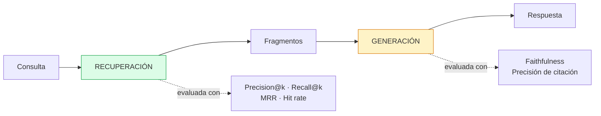

# Evaluación del Sistema RAG — Síntesis

**Sprint 1 — Ingeniería del Conocimiento y Sistemas RAG**
Plataforma Inteligente Wellness 2.0 · Equipo 1

---

## 1. Marco de evaluación

Un sistema RAG se evalúa en dos etapas independientes, porque fallan por causas distintas y admiten remedios distintos.

Si la recuperación falla, la generación no puede compensarlo: el modelo no puede fundamentar una respuesta en conocimiento que nunca recibió. Por eso la evaluación separada tiene valor diagnóstico — identifica **dónde** está el problema, no solo que existe.

---

## 2. Instrumentos

| Instrumento | Ubicación | Cobertura |
|---|---|---|
| Conjunto de referencia | `data/evaluation/golden_set.json` | 18 casos, 7 categorías |
| Métricas de recuperación | `src/evaluation/metrics.py` | Precision@k, Recall@k, MRR, Hit rate |
| Script de evaluación | `scripts/evaluation/evaluate_retrieval.py` | Ejecución y agregación |
| Validación de citación | `src/rag/pipeline/rag_pipeline.py` | `validar_fuentes()` |
| Comparación de arquitecturas | `POST /agent/{userId}/compare` | legacy frente a rag |

---

## 3. Resultados consolidados

### Recuperación

| Métrica | k = 5 | k = 3 |
|---|---|---|
| Precision@k | 0.767 | **0.815** |
| Recall@k | 0.944 | 0.944 |
| MRR | 0.944 | 0.944 |
| Hit rate | 17/18 | 17/18 |

**Configuración adoptada: k = 3**, por precisión superior con cobertura idéntica.

### Generación

| Indicador | Valor |
|---|---|
| Precisión de citación (tras instrucción 7) | 1.000 |
| Citas alucinadas detectadas y descartadas | 1 caso documentado |
| Anclaje al corpus verificado manualmente | 4 afirmaciones trazadas a su fragmento |
| Faithfulness cuantitativa | **No implementada** |

---

## 4. Hallazgos

### 4.1 k=3 supera a k=5

Recall, MRR y tasa de acierto idénticos; precisión superior con menos fragmentos. Los fragmentos cuarto y quinto no aportaban documentos relevantes adicionales — únicamente diluían el contexto y consumían ventana del prompt.

Decisión de diseño derivada de medición, no de criterio.

### 4.2 MRR perfecto sobre los casos con acierto

En los 17 casos que recuperaron el documento esperado, **el primer fragmento siempre pertenecía a ese documento**. No hay casos donde lo relevante aparezca en segunda o tercera posición.

Es el resultado más sólido: cuando el sistema encuentra, encuentra bien y ordena bien.

### 4.3 La brecha de registro lingüístico es el modo de falla dominante

El único fallo del conjunto (EV-16) se debe a distancia entre el registro coloquial del usuario —*"como muy poco"*— y el registro técnico del corpus —*"disponibilidad energética"*.

Es el modo de falla característico de RAG, y no un defecto de implementación. Se conservó documentado en lugar de corregirse, por razones metodológicas expuestas en `docs/evaluation/retrieval-metrics.md`.

### 4.4 Las citas alucinadas requieren defensa programática

El modelo citó un documento que no había recibido. La instrucción de prompt redujo la incidencia; la validación en código la eliminó.

**Principio:** el prompt reduce la frecuencia del error; solo el código lo garantiza.

Corolario detectado: limpiar el array de fuentes no protege el texto libre. Cada superficie donde el modelo puede citar requiere su propia defensa.

### 4.5 La consulta condiciona la recuperación tanto como el índice

Una versión previa de la síntesis de consulta incorporaba el término *"tapering"* de forma incondicional, provocando que 3 de 5 fragmentos recuperados procedieran del documento equivocado.

El retriever funcionaba correctamente: recuperaba con precisión lo que la consulta pedía. La consulta pedía mal.

---

## 5. Trazabilidad de los documentos de evaluación

| Documento | Contenido |
|---|---|
| `docs/evaluation/retrieval-metrics.md` | Métricas, resultados por categoría, análisis del caso fallido |
| `docs/evaluation/test-cases.md` | Inventario completo de los 18 casos y casos del pipeline |
| `docs/evaluation/response-quality.md` | Precisión de citación, comparación legacy/RAG, carencias |

---

## 6. Limitaciones metodológicas

Se enumeran de forma explícita por transparencia:

| Limitación | Impacto |
|---|---|
| Conjunto de 18 casos | Sin potencia estadística para comparaciones finas |
| Anotación por el mismo equipo curador | Riesgo de sesgo de confirmación |
| Relevancia binaria | Impide métricas de relevancia graduada (nDCG) |
| Faithfulness no implementada | Etapa de generación evaluada solo parcialmente |
| Latencia con una sola muestra | No permite conclusión |
| Evaluación sobre consultas directas, no sintetizadas | Brecha entre lo medido y el uso real del agente |
| Sin pruebas de regresión automatizadas | Una modificación puede degradar sin señal |

---

## 7. Trabajo pendiente

**Prioridad alta**

- Implementar evaluación de faithfulness y answer relevance con LLM evaluador
- Evaluar la recuperación sobre consultas sintetizadas, no solo sobre consultas directas
- Pruebas de regresión con umbral mínimo sobre las métricas del conjunto de referencia

**Prioridad media**

- Ampliar el conjunto de referencia a 40–50 casos con anotación independiente
- Benchmark de latencia con N ejecuciones y reporte de mediana
- Expansión de consulta mediante LLM para mitigar la brecha de registro

**Prioridad baja**

- Relevancia graduada y nDCG
- Búsqueda híbrida BM25 + semántica
- Optimización empírica de los parámetros de chunking
