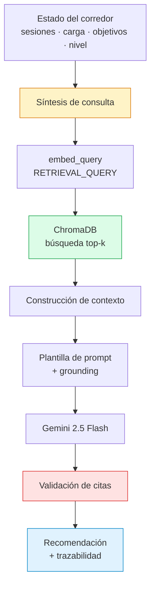

# Pipeline de Recuperación y Generación

**Sprint 1 — Ingeniería del Conocimiento y Sistemas RAG**
Plataforma Inteligente Wellness 2.0 · Equipo 1

Implementación: [`src/rag/retriever/retriever.py`](../../src/rag/retriever/retriever.py) · [`src/rag/pipeline/rag_pipeline.py`](../../src/rag/pipeline/rag_pipeline.py) · [`src/rag/generation/generator.py`](../../src/rag/generation/generator.py)

---

## 1. Visión general



Dos etapas del diagrama merecen atención particular por no ser estándar en implementaciones de RAG orientadas a preguntas: la **síntesis de consulta** (paso B) y la **validación de citas** (paso H).

---

## 2. Síntesis de consulta

### El problema

Un sistema RAG convencional recibe una pregunta del usuario y la embebe directamente. **El agente wellness no recibe preguntas**: recibe el estado de entrenamiento de un corredor y debe emitir una recomendación.

No hay consulta que embeber. Hay que construirla.

### La solución

`construir_consulta()` traduce el estado estructurado a una descripción en lenguaje natural apta para recuperación semántica:

```
corredor de nivel principiante, volumen semanal actual 19 km,
semana anterior 13 km, variación de carga 46.2%, progresión de carga,
ACWR y riesgo de lesión por sobreuso, meta de volumen semanal 30 km,
corredor sin experiencia previa, factores de riesgo de lesión en novatos
```

La construcción es condicional: la consulta incorpora términos según lo que el estado revela.

| Condición | Término añadido |
|---|---|
| Última sesión hace más de 21 días | *retorno tras interrupción prolongada, pérdida de carga crónica* |
| Sin actividad en ambas semanas | *construcción de base aeróbica desde cero* |
| Variación > 10 % | *progresión de carga, ACWR y riesgo de lesión por sobreuso* |
| Variación < −20 % | *reducción de carga y recuperación* |
| Volumen por encima de la meta | *gestión de carga* |
| Volumen < 50 % de la meta | *progresión segura del volumen semanal* |
| Nivel principiante | *sin experiencia previa, factores de riesgo en novatos* |

### Hallazgo: la consulta condiciona la recuperación

Una versión previa incorporaba el término *"tapering"* siempre que existía una fecha objetivo, sin evaluar su proximidad. El efecto fue inmediato: con una meta a nueve semanas, **3 de 5 fragmentos recuperados provenían del documento de tapering** en lugar del de carga de entrenamiento.

El retriever funcionaba correctamente. Recuperaba con precisión el conocimiento que la consulta pedía — pero la consulta pedía lo equivocado.

> La calidad de la recuperación está acotada por la calidad de la consulta. Un retriever perfecto sobre una consulta mal construida recupera con precisión lo que no se necesita.

La corrección introdujo evaluación de la fase de entrenamiento en función de las semanas restantes. Posteriormente, al conocerse el esquema real de objetivos de la plataforma —metas de volumen sin fecha de competición—, esa lógica quedó sin aplicación efectiva, tal como se documenta en `docs/knowledge/ontology.md`.

---

## 3. Recuperación

### Interfaz

```python
def recuperar(
    consulta: str,
    k: int = TOP_K,
    categoria: str | None = None,
    nivel_evidencia: str | None = None,
) -> list[dict]
```

La consulta se embebe con `task_type="RETRIEVAL_QUERY"`, distinto del empleado en la indexación. La justificación se detalla en `docs/rag/embeddings-strategy.md`.

### Búsqueda híbrida

Los parámetros `categoria` y `nivel_evidencia` acotan el espacio de búsqueda mediante filtro de metadata antes del cálculo de similitud:

```python
recuperar("cuánto debo consumir al entrenar", k=3, categoria="nutricion")
```

ChromaDB exige envolver múltiples condiciones en `$and`, lo que el retriever gestiona internamente.

Esta capacidad tiene utilidad inmediata para acotar consultas ambiguas, y utilidad prospectiva mayor: en el Sprint 3 cada agente especializado consultará únicamente su dominio mediante este mismo mecanismo.

### Valor de k

`TOP_K = 3`, fijado a partir de evidencia empírica documentada en `docs/evaluation/retrieval-metrics.md`. La evaluación comparativa entre k=3 y k=5 arrojó recall, MRR y tasa de acierto idénticos, con precisión superior en k=3 — los fragmentos cuarto y quinto no aportaban contenido relevante y diluían el contexto.

---

## 4. Construcción del contexto

Los fragmentos recuperados se formatean con su procedencia y calificación antes de insertarse en el prompt:

```
--- FRAGMENTO 1 [KB-004] (evidencia: moderado, similitud: 0.768) ---
[Prevención de lesiones por sobreuso en corredores › Factores de riesgo con mejor respaldo]

Las revisiones sistemáticas disponibles permiten ordenar los factores...
```

Tres elementos deliberados:

- **`doc_id`** — permite al modelo citar con precisión y habilita la validación posterior
- **`nivel_evidencia`** — permite modular la firmeza de las afirmaciones según la solidez del respaldo
- **`similitud`** — informa al modelo del grado de correspondencia de cada fragmento con la situación

---

## 5. Prompt de grounding

La diferencia entre *un modelo con texto adjunto* y *un sistema RAG* reside en las instrucciones de anclaje. La plantilla (`prompts/rag/wellness_rag.txt`) declara ocho:

| # | Instrucción | Propósito |
|---|---|---|
| 1 | Fundamentar exclusivamente en el conocimiento recuperado | Anclaje al corpus |
| 2 | Reflejar los matices cuando el conocimiento cuestione una práctica común | Evita simplificación |
| 3 | Declarar explícitamente cuando el contexto sea insuficiente | Evita relleno paramétrico |
| 4 | Ajustar al nivel del corredor | Personalización |
| 5 | Atender al campo `diasAtras` de las sesiones | Razonamiento temporal |
| 6 | Citar por `doc_id` | Trazabilidad |
| 7 | Citar únicamente documentos efectivamente recibidos | Mitigación de alucinación |
| 8 | No incluir identificadores en los campos de prosa | Separación de responsabilidades |

La instrucción 3 es la más relevante conceptualmente. Sin ella, el modelo completa las lagunas con conocimiento paramétrico y se pierde la trazabilidad — precisamente la propiedad que el sistema pretende garantizar.

### Contexto temporal

Los modelos de lenguaje **no conocen la fecha actual**. Una versión previa produjo una recomendación que afirmaba *"has corrido 15 km hoy"* sobre sesiones registradas tres meses antes.

La corrección consistió en inyectar la fecha actual en el prompt y enriquecer cada sesión con un campo `diasAtras` calculado:

```python
def enriquecer_sesiones(sessions: list) -> list:
    for s in sessions:
        copia["diasAtras"] = dias_desde(s.get("fecha"))
```

Delegar la aritmética de fechas al modelo es innecesario y poco fiable cuando puede resolverse de forma determinista.

---

## 6. Generación

```python
respuesta = model.generate_content(
    prompt,
    generation_config=GenerationConfig(
        temperature=0.2,
        response_mime_type="application/json",
    ),
)
```

**Temperatura 0.2.** Se busca consistencia, no creatividad. Ante un mismo estado del corredor, la recomendación debe ser estable.

**`response_mime_type="application/json"`.** Fuerza salida JSON estructurada a nivel de API, reduciendo la necesidad de post-procesamiento. Se conserva no obstante una función de limpieza de cercado markdown como salvaguarda.

### Esquema de salida

```json
{
  "tipo": "recuperacion | rodaje | intervalos | tempo | tirada_larga | descanso",
  "mensaje": "recomendación personalizada, máximo 100 palabras",
  "fundamento": "por qué, referido al conocimiento recuperado, máximo 60 palabras",
  "alerta": null,
  "prioridad": "baja | media | alta",
  "fuentes": ["KB-XXX"],
  "confianza": "alta | media | baja"
}
```

Los campos `fundamento`, `fuentes` y `confianza` no existen en el modo legacy: son aportación directa de la arquitectura RAG.

---

## 7. Validación de citas

### El problema detectado

En una ejecución de prueba el modelo produjo:

```json
"fuentes": ["KB-004", "KB-005"]
```

**KB-005 no había sido recuperado.** Los fragmentos entregados procedían de KB-004 (×4) y KB-001 (×1). El modelo citó un documento que nunca recibió.

Este modo de falla —**cita alucinada**— es particularmente traicionero: la respuesta es correcta, el formato es válido, pero la atribución es falsa. En un sistema cuya ventaja declarada es la trazabilidad, una cita inventada anula el beneficio completo.

### La defensa

La instrucción de prompt reduce la frecuencia del problema pero no lo elimina. La garantía debe ser programática:

```python
def validar_fuentes(fuentes_citadas, chunks):
    disponibles = {c["metadata"]["doc_id"] for c in chunks}
    citadas = [str(f).strip() for f in (fuentes_citadas or [])]
    validas = [f for f in citadas if f in disponibles]
    inventadas = [f for f in citadas if f not in disponibles]
    return validas, inventadas
```

Las fuentes inventadas se descartan del campo `fuentes` y se registran en la metadata de trazabilidad junto con una métrica de precisión de citación:

```
Precisión de citas : 0.667
Fuentes inventadas : ['KB-005']  ← descartadas
```

### Principio general

> El prompt reduce la frecuencia del error. Solo el código lo garantiza.

Cada superficie donde el modelo puede citar requiere su propia defensa. Tras validar el array `fuentes`, se detectó que la cita inventada persistía **en el texto libre** del campo `fundamento`. La respuesta fue la instrucción 8 del prompt, que prohíbe identificadores en los campos de prosa.

---

## 8. Trazabilidad

Cada respuesta incorpora metadata de auditoría:

```json
"_rag": {
  "consulta_recuperacion": "corredor de nivel principiante, ...",
  "chunks_recuperados": [
    {"doc_id": "KB-004", "seccion": "Factores de riesgo...", "similitud": 0.7681},
    {"doc_id": "KB-001", "seccion": "La regla del 10%...", "similitud": 0.7389}
  ],
  "fuentes_inventadas": ["KB-005"],
  "precision_citas": 0.667
}
```

Este bloque permite auditar cada recomendación: qué se buscó, qué se recuperó, con qué grado de correspondencia y si el modelo citó correctamente.

No se persiste en Firestore por volumen; su valor es la inspección en vivo y la evaluación.

---

## 9. Modo dual

El agente admite dos modos de operación sobre el mismo estado:

```python
def analyze(self, user_id: str, mode: str = "rag", persistir: bool = True)
```

| Modo | Flujo |
|---|---|
| `legacy` | Prompt estático con conocimiento embebido en código. Arquitectura previa al sprint |
| `rag` | Recuperación sobre knowledge base curada y generación fundamentada |

Expuesto vía API:

```
POST /agent/{userId}/analyze?mode=rag
POST /agent/{userId}/analyze?mode=legacy
POST /agent/{userId}/compare
```

El endpoint `/compare` ejecuta ambos flujos sobre el mismo estado y devuelve las dos respuestas con sus latencias y la trazabilidad del flujo RAG. No persiste resultados: es una operación de demostración y evaluación.

Esta capacidad excede lo requerido por el sprint. Se incorporó para permitir comparación empírica directa entre arquitecturas, cuyos resultados se documentan en `docs/evaluation/response-quality.md`.
