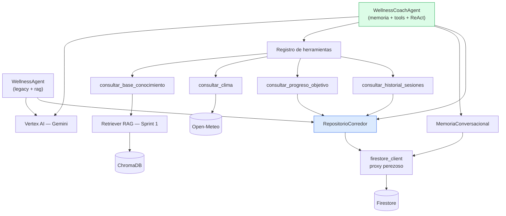
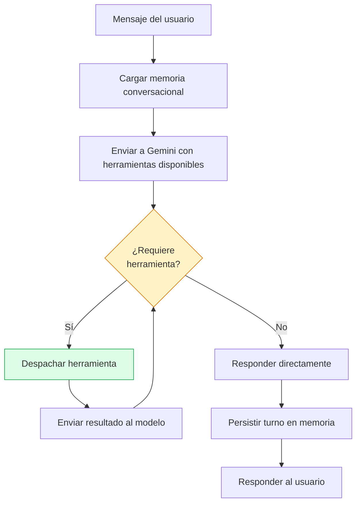

# Informe de Cierre — Sprint 2: Agentes Inteligentes Modernos

**Plataforma Inteligente Wellness 2.0 · Equipo 1**
Maestría en Tecnologías de Información y Comunicación — Universidad del Zulia
Asignatura: Sistemas Inteligentes · Docente: Dra. Yaskelly Yedra

Julio César Matute (frontend/UI) · José Francisco Urdaneta Sánchez (backend/infraestructura/IA)

---

## 1. Resumen ejecutivo

El Sprint 2 evolucionó el sistema del Sprint 1 —un agente de recomendación
de un solo turno con dos modos (`legacy` y `rag`)— hacia un segundo agente,
el **Wellness Coach Agent 2.0**: conversacional, con memoria de largo plazo,
capaz de decidir en tiempo real qué herramientas invocar (tool calling) y
de razonar en varios pasos siguiendo el patrón ReAct.

Ambos agentes coexisten. El `WellnessAgent` original sigue generando
recomendaciones automáticas comparables entre sus dos modos; el
`WellnessCoachAgent` se expone como un canal conversacional adicional. No
se descartó nada del Sprint 1: se construyó sobre esa base, reutilizando su
pipeline RAG, su knowledge base curada y su cliente de Firestore.

Se completaron los siete issues del sprint (#10 a #16). La refactorización
inicial (#10) extrajo el acceso a datos del corredor a un componente
compartido, resolviendo de paso una deuda técnica de configuración
dispersa y de inicialización no perezosa de Firestore que habría bloqueado
las pruebas unitarias del resto del sprint. El diseño (#11), la memoria
(#12), las herramientas (#13) y el ciclo ReAct (#14) se implementaron
secuencialmente, cada uno verificado primero con pruebas unitarias
(mocks) y después contra servicios reales (Vertex AI, Firestore, ChromaDB,
Open-Meteo).

La evaluación (#15) fue la fase más reveladora del sprint. Cinco rondas de
medición contra servicios reales encontraron **seis defectos** que ninguna
de las 50 pruebas unitarias con mocks había detectado — porque, por
diseño, un mock nunca falla como falla un servicio real. La tasa de
acierto de herramientas del agente pasó de 70% en la primera medición a
**100% en la quinta y última**, con cada corrección documentada junto a la
evidencia que la motivó.

## 2. Arquitectura actualizada del sistema

### 2.1 Decisión de framework

Se evaluaron tres opciones antes de iniciar el sprint: Google ADK,
LangGraph, e implementación directa sobre el SDK de Vertex AI. Se optó por
**SDK directo**, consistente con la filosofía de "stack mínimo" adoptada en
el Sprint 1, por tres razones: (1) evitar el riesgo de conflicto de
dependencias que ya había descartado `langchain-google-vertexai` en el
Sprint 1; (2) mantener transparencia total del ciclo de razonamiento,
defendible línea por línea en la evaluación académica; (3) el Sprint 2
involucra un solo agente nuevo, no coordinación multiagente — el caso de
uso donde LangGraph aporta valor real se pospone al Sprint 3.

### 2.2 Componentes y su relación



`RepositorioCorredor` (extraído en #10) es el único punto de acceso a los
datos de entrenamiento del corredor, compartido por ambos agentes — evita
que el coach agent duplique las cuatro consultas a Firestore que ya
resolvía el agente original.

### 2.3 Refactorización del Wellness Agent (#10)

Antes del sprint, `WellnessAgent` mezclaba tres responsabilidades: acceso
a datos, generación de recomendación, y orquestación. Se extrajo el acceso
a datos a `src/data/repositorio_corredor.py`, con `PerfilCorredor` y
`EstadoCorredor` como `dataclasses` (en vez de diccionarios crudos) para
manejar de forma explícita campos que pueden estar ausentes en perfiles
antiguos, como el `ciudad` agregado este sprint.

De paso se resolvió una deuda técnica del Sprint 1: `firestore_client.py`
se conectaba a Firestore al **importarse**, no al usarse, lo que impedía
escribir pruebas unitarias con mocks para cualquier módulo que dependiera
de él. Se corrigió con un patrón de inicialización perezosa
(`_ClienteFirestorePerezoso`), con un detalle no trivial: hubo que excluir
explícitamente los atributos que empiezan con guion bajo, porque
`unittest.mock` los consulta durante su propia introspección antes de
reemplazar un objeto, y esa consulta disparaba la conexión real sin que
nadie la hubiera pedido.

También se centralizó la configuración de GCP (`src/utils/config.py`),
que antes estaba duplicada en cuatro módulos distintos.

## 3. Diseño del Wellness Coach Agent 2.0 (#11)

### 3.1 Propósito y responsabilidades

El coach agent sostiene una **conversación** con el corredor — a
diferencia del `WellnessAgent`, que genera una recomendación de un solo
turno sin diálogo. Puede preguntar, matizar, y recordar lo dicho en turnos
anteriores. No reemplaza al agente original: es un canal adicional.

Responsabilidades: sostener contexto conversacional; decidir en cada
turno si necesita invocar una herramienta; fundamentar respuestas de
dominio en la base de conocimiento curada, preservando la trazabilidad que
es la ventaja central del sistema desde el Sprint 1; razonar en múltiples
pasos cuando la pregunta lo requiere.

### 3.2 Ubicación en el código

```
src/agents/wellness_coach/
    agent.py          # WellnessCoachAgent — orquestador ReAct
    memory.py         # MemoriaConversacional
    tools/
        historial.py     # consultar_historial_sesiones, consultar_progreso_objetivo
        clima.py         # consultar_clima
        conocimiento.py  # consultar_base_conocimiento
        registro.py      # declaraciones + despacho
```

Paquete independiente de `src/agents/wellness/` (el agente original),
siguiendo la simetría con `nutrition/`, `motivation/`, `analytics/`
reservados para el Sprint 3.

## 4. Memoria conversacional (#12)

Un hilo de conversación por corredor (`conversation_id == user_id`),
persistido en Firestore, colección `conversations`. Se recorta a un máximo
de 50 turnos guardados; se expone al modelo una ventana de los 10 más
recientes, formateados como texto plano dentro del prompt de sistema.

No se persiste el objeto `ChatSession` del SDK entre peticiones —no es
serializable a Firestore de forma directa, y cada conversación con el
agente es una petición HTTP independiente. El historial se reconstruye
como texto en cada turno nuevo a partir de lo guardado.

## 5. Herramientas y Tool Calling (#13)

Cuatro herramientas, todas envolviendo componentes ya existentes en el
repositorio, sin duplicar lógica:

| Herramienta | Envuelve | Depende de |
|---|---|---|
| `consultar_historial_sesiones` | `RepositorioCorredor` | Firestore |
| `consultar_progreso_objetivo` | `RepositorioCorredor` | Firestore |
| `consultar_clima` | Nueva integración con Open-Meteo | Red, `ciudad` del perfil |
| `consultar_base_conocimiento` | Retriever RAG del Sprint 1 | ChromaDB + embeddings |

Se eligió **Open-Meteo** por no requerir API key, eliminando un segundo
frente de gestión de credenciales.

Un hallazgo de diseño no trivial durante la implementación: los objetos
`Tool` y `FunctionDeclaration` del SDK de Vertex AI están respaldados por
protobuf y no garantizan lectura de sus propios valores tras construirse
—son objetos de *petición*, diseñados para escribirse, no releerse—, a
diferencia de `FunctionCall` (objeto de *respuesta* del modelo), que sí es
legible. Esto llevó a rediseñar `registro.py` para mantener una lista de
diccionarios Python simples (`_HERRAMIENTAS`) como única fuente de verdad,
inspeccionable en pruebas, construyendo los objetos del SDK a partir de
ella solo en el momento de uso, sin volver a leerlos.

## 6. Flujo de razonamiento ReAct (#14)



Ciclo manual sobre `chat.send_message()`, acotado a
`MAX_ITERACIONES_HERRAMIENTAS = 5` para evitar llamadas reiteradas sin
converger, exigido por el criterio de aceptación del issue.

## 7. Tecnologías utilizadas

| Componente | Tecnología |
|---|---|
| Modelo generativo | Gemini 2.5 Flash (Vertex AI SDK, `vertexai.generative_models`) |
| Embeddings | text-embedding-004 |
| Base vectorial | ChromaDB (Sprint 1, reutilizada sin cambios) |
| Persistencia | Cloud Firestore |
| Servicio de clima | Open-Meteo (sin API key) |
| Cliente HTTP | `requests` |
| Framework de agentes | Ninguno — SDK directo (ver §2.1) |
| Pruebas | `unittest` + `unittest.mock` |

## 8. Resultados obtenidos durante las pruebas (#15)

### 8.1 Metodología

Golden set de 10 casos (`data/evaluation/agent_golden_set.json`) cubriendo
seis tipos de comportamiento: sin herramientas, tool calling, RAG,
memoria multi-turno, razonamiento ReAct encadenado, y límite de alcance
del dominio. Un usuario de prueba fijo, sembrado antes de cada corrida
(`scripts/evaluation/seed_agent_test_user.py`), con memoria limpiada al
inicio de cada caso (no solo al sembrar) para evitar contaminación entre
casos.

La reproducibilidad de esa siembra resultó ser, durante casi todo el
sprint, más frágil de lo que se creía: las sesiones se fechaban relativas
al día de hoy mientras la carga semanal se agrupa por semana calendario,
de modo que el estado sembrado dependía del día en que se ejecutara la
evaluación. Corregido al cerrar el sprint; el análisis está en
`docs/evaluation/agent-evaluation.md`, sección 5.1.

El criterio de acierto es de subconjunto —¿se invocó al menos lo
esperado?— lo que significa que **mide recall de herramientas, no
precisión**: invocar de más no penaliza, y los casos que esperan cero
herramientas no pueden fallar. Ver sección 1.1 del documento de
evaluación.

### 8.2 Evolución de la tasa de acierto

| Métrica | v1 | v3 | v4 | v5 |
|---|---|---|---|---|
| Tasa de acierto de herramientas | 70.0% | 90.0% | 90.0% | **100.0%** |
| Latencia promedio | 8714 ms | 8544 ms | 7516 ms | 7466 ms |
| Casos completados | 10/10 | 10/10 | 10/10 | 10/10 |
| Casos con límite de iteraciones | 0 | 0 | 0 | 0 |

(v2 se abortó a mitad de corrida por el hallazgo D; no produjo un archivo
de resultados completo.)

### 8.3 Los seis hallazgos

Cada uno se detectó exclusivamente en medición contra servicios reales —
ninguno era detectable con las 50 pruebas unitarias con mocks, que se
mantuvieron en verde durante las cinco rondas.

**Hallazgo A — Memoria contaminada entre casos.** La memoria conversacional
se limpiaba solo al sembrar el usuario de prueba, no entre cada caso del
golden set. Un caso multi-turno que introducía dolor de rodilla
contaminaba las respuestas de los casos posteriores en la misma corrida,
haciendo la evaluación no reproducible. *Corrección:* limpiar la memoria
al inicio de cada caso, preservando la acumulación dentro de un mismo caso
multi-turno.

**Hallazgo B — Usuario de prueba sin ciudad.** El caso que esperaba
`consultar_clima` no podía pasar por diseño, porque el perfil sembrado no
incluía `ciudad`. El agente razonaba correctamente al no invocar una
herramienta sin datos suficientes — el defecto estaba en el caso de
prueba, no en el agente. *Corrección:* agregar `ciudad` al perfil
sembrado.

**Hallazgo C — Declaración de uso de herramienta sin invocarla.** El
modelo, en algunos turnos, narraba la intención de usar una herramienta
("voy a consultar la base de conocimiento") o directamente atribuía
contenido a ella ("según la base de conocimiento...") sin emitir una
llamada a función real — el mismo problema de cita alucinada del Sprint 1,
en la superficie conversacional. Se investigó `ToolConfig` con
`FunctionCallingConfig.Mode.ANY` como alternativa estructural para forzar
la llamada; se descartó porque `ChatSession.send_message()` no acepta
`tool_config` por mensaje (confirmado contra la documentación oficial), y
aplicarlo a nivel de modelo completo habría forzado una llamada en cada
turno, incluidos los que legítimamente no la requieren. *Corrección:* una
heurística textual con un reintento acotado a una vez por turno; si el
reintento tampoco produce una llamada real, se descarta el texto del
modelo y se sustituye por una respuesta honesta, en vez de confiar en una
segunda promesa.

**Hallazgo D — La herramienta de clima no toleraba fallos del servicio.**
Un error HTTP 500 real de Open-Meteo, sin capturar, propagaba la excepción
por toda la pila y tumbaba la conversación completa del agente, aunque
este tuviera otras tres fuentes de información con las que responder.
*Corrección:* capturar `requests.RequestException` y `ValueError` en
ambas llamadas de red (geocodificación y pronóstico), devolviendo el
mismo contrato `{"disponible": False, "mensaje": ...}` que ya usaban los
otros casos de fallo — el modelo ya sabía interpretarlo. Deliberadamente
sin reintentos con backoff, para no multiplicar la latencia de una
conversación que ya promedia varios segundos.

**Hallazgo E — El agente prefería preguntar antes que consultar.** En el
único caso de tipo `react` del golden set, el agente le preguntó al
corredor su kilometraje semanal en vez de invocar
`consultar_progreso_objetivo`, que expone exactamente ese dato. El prompt
describía cuándo usar cada herramienta de forma aislada, sin un principio
general sobre preguntar vs. consultar. *Corrección:* un principio de
precedencia explícito, reservando las preguntas para lo que ninguna
herramienta puede dar (percepciones subjetivas, intenciones).

**Hallazgo F — La corrección de E desplazó el comportamiento, no lo
eliminó.** El principio de precedencia se había acotado a "un dato del
corredor"; la base de conocimiento no es un dato del corredor sino
conocimiento de dominio, así que quedaba fuera del alcance literal de la
regla. El mismo caso `react` dejó de preguntar el kilometraje —consultó el
progreso correctamente— pero cerró su respuesta *pidiendo permiso* para
consultar la base de conocimiento, en vez de hacerlo. La causa de fondo no
era el dato específico, sino el patrón de delegar en el usuario una
decisión que corresponde al agente. *Corrección:* ampliar el principio a
cualquier información disponible vía herramienta, prohibir explícitamente
pedir permiso antes de invocar, y habilitar el encadenamiento de varias
herramientas en un mismo turno. Verificado sin regresiones en los cinco
casos sensibles a sobre-invocación.

El par E+F es, en sí mismo, un resultado de valor para el sprint: muestra
que una corrección de prompt puede desplazar un comportamiento en lugar de
eliminarlo cuando la regla se escribe sobre una categoría más estrecha que
el patrón real, y que la métrica agregada puede ocultarlo por completo —
90% en v3 y 90% en v4 fueron el mismo número sobre dos fallos opuestos,
visibles solo inspeccionando la respuesta textual completa de cada caso,
no solo si acertó o no.

### 8.4 Calidad de las respuestas

Más allá de la tasa de acierto de herramientas, la inspección cualitativa
de las respuestas (documentada en `docs/evaluation/agent-evaluation.md`)
confirmó: ninguna respuesta emitió diagnóstico médico ante síntomas
descritos (AG-05, límite de alcance respetado); las citas a la base de
conocimiento, una vez corregido el hallazgo C, se limitaron a `doc_id`
realmente recibidos de la herramienta; el caso de límite de dominio (AG-09,
pregunta sobre películas) redirigió la conversación sin intentar
responderla.

## 9. Limitaciones conocidas

- **El marco de evaluación mide recall de herramientas, no precisión.** El
  criterio de subconjunto no penaliza invocar de más: en la quinta corrida
  AG-07 invocó cinco herramientas donde se esperaban dos y se contabilizó
  como acierto. Los casos que esperan cero herramientas (AG-01, AG-09)
  tampoco pueden fallar, porque el conjunto vacío es subconjunto de
  cualquier cosa; que no invocaran nada se verificó leyendo el JSON de
  resultados, no por la métrica.
- **La knowledge base no cubre entrenamiento en calor ni humedad.** Es la
  laguna que provocó las tres consultas repetidas de AG-07, y es relevante
  para el clima de Maracaibo, donde vive el usuario de prueba.
- **AG-10 está mal etiquetado** como `sin_herramientas` cuando espera una
  herramienta, lo que hace engañoso el desglose por tipo sin afectar la
  tasa global.
- **El ejemplo del principio de precedencia reproduce casi literalmente el
  enunciado de AG-08**, de modo que parte de su acierto en la quinta
  corrida puede deberse a esa cercanía y no a generalización del modelo.
- **La heurística del hallazgo C es textual, no estructural.** Depende de
  una lista de frases en español que puede tener falsos negativos (una
  formulación del modelo no contemplada) o falsos positivos (un reintento
  gastado innecesariamente). No es una garantía programática como
  `validar_fuentes()` del Sprint 1.
- **El golden set tiene un solo caso de tipo `react`.** Su métrica es
  binaria (0% o 100%), sin puntos intermedios — la categoría peor medida
  del conjunto.
- **El SDK `vertexai.generative_models` está deprecado**, con retiro
  anunciado para junio de 2026. La migración a `google-genai` se decidió
  posponer, consistente con la decisión de mantener el stack mínimo
  durante este sprint.
- **La memoria conversacional no tiene límite de expiración temporal**,
  solo de cantidad de turnos — una conversación de hace meses sigue
  disponible como contexto igual que una de hace minutos.
- **`_geocodificar()` colapsa "ciudad inexistente" y "servicio caído" al
  mismo resultado** (`None`), por lo que el mensaje que recibe el usuario
  no distingue ambos casos, aunque para el usuario final el efecto
  práctico es el mismo.

## 10. Propuestas de mejora (Sprint 3)

- Registrar precisión además de recall en las métricas de evaluación:
  contabilizar las invocaciones no esperadas, y exigir igualdad en vez de
  subconjunto para los casos que esperan cero herramientas.
- Curar documentación sobre entrenamiento en calor y humedad para la
  knowledge base.
- Corregir la etiqueta de tipo de AG-10.
- Ampliar el golden set con más casos de tipo `react`, para una métrica
  menos binaria en esa categoría.
- Evaluar la migración a `google-genai` antes de que se retire el SDK
  actual.
- Considerar `LangGraph` para la orquestación multiagente del Sprint 3
  (nutrition, motivation, analytics), donde su caso de uso —coordinar
  varios agentes— sí justifica la dependencia, a diferencia de este
  sprint.
- Evaluar si versiones más recientes del SDK de Vertex AI permiten aplicar
  `tool_config` por mensaje dentro de una sesión de chat, lo que
  permitiría reemplazar la heurística del hallazgo C por una garantía
  estructural.
- Expirar turnos de memoria conversacional por antigüedad, no solo por
  cantidad.

## 11. Conclusión

El sprint cumplió los siete issues planteados, con una decisión consistente
de mantener el stack mínimo del Sprint 1 en vez de adoptar un framework de
agentes. El proceso de evaluación resultó más valioso que un simple
checklist de aceptación: cada uno de los seis hallazgos surgió de medir
contra servicios reales, y cada corrección quedó documentada con su causa
raíz, su evidencia, y su verificación posterior — incluyendo un caso
(hallazgo F) donde una corrección aparentemente exitosa resultó estar
incompleta, y solo la inspección cualitativa lo reveló. La tasa de acierto
de herramientas cerró en 100%, pero el valor académico del sprint está
tanto en ese número final como en el camino documentado para llegar a él.